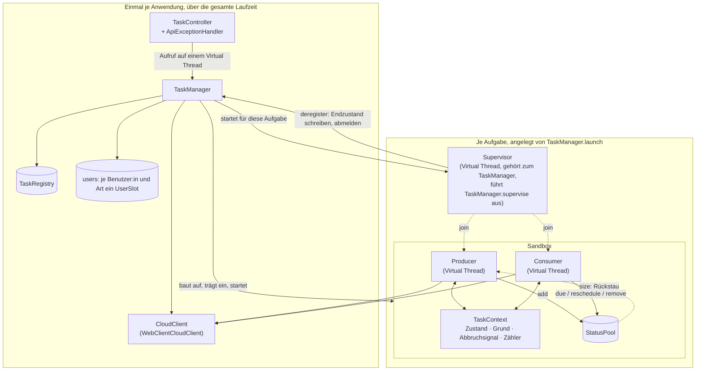
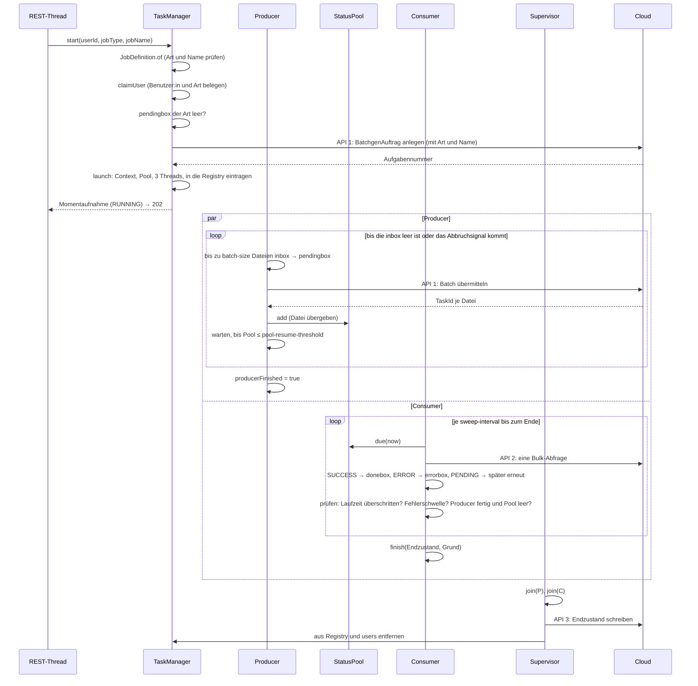
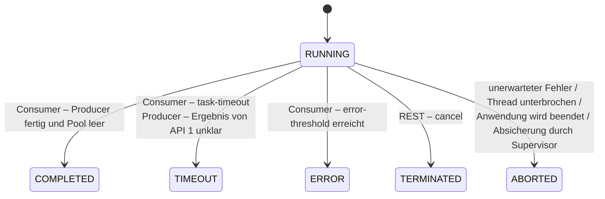
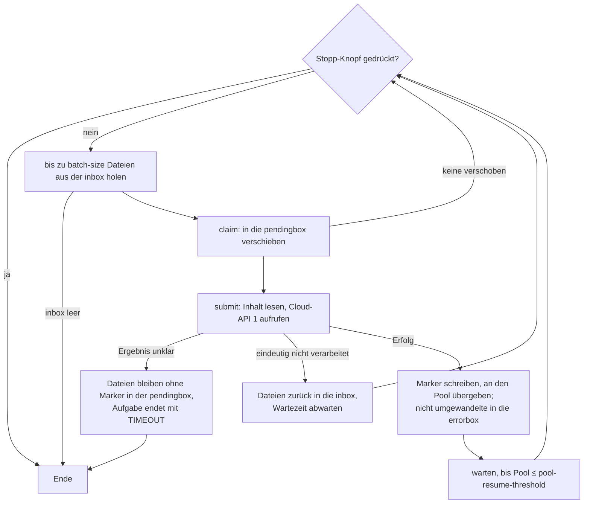
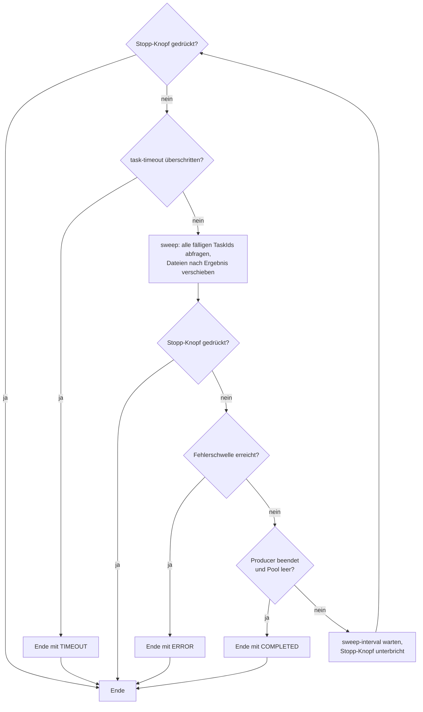

# Asynchrone Testdaten-Pipeline – Implementierung

Dieses Dokument beschreibt den aktuellen Code: Für jedes Paket, jede Klasse und jede Methode, was sie tut und warum sie
so gebaut ist. Ausführlich erklärt wird außerdem, wie Producer, Consumer, TaskManager und TaskContext zusammenarbeiten.

- Den fachlichen Ablauf legt [`funktionsweise_sequenz.md`](funktionsweise_sequenz.md) fest; „Abschnitt n“ in den
  Code-Kommentaren bezieht sich auf dessen Abschnitt n. Dieses Dokument beschreibt die Umsetzung im Code.
- Bedienung, REST-API und Konfiguration im Überblick stehen in der [`README.md`](../../README.md).
- Eine chinesische Fassung dieses Dokuments ist [`implementierung_zh.md`](implementierung_zh.md).

## Inhalt

1. [Überblick](#1-überblick)
2. [Kernmechanismen](#2-kernmechanismen)
   - 2.1 [Lebenszyklus einer Aufgabe](#21-lebenszyklus-einer-aufgabe)
   - 2.2 [TaskContext: gemeinsamer Zustand und einmaliges Ende](#22-taskcontext-gemeinsamer-zustand-und-einmaliges-ende)
   - 2.3 [Zusammenspiel von Producer und Consumer](#23-zusammenspiel-von-producer-und-consumer)
   - 2.4 [Wie der TaskManager Sandboxen und Threads verwaltet](#24-wie-der-taskmanager-sandboxen-und-threads-verwaltet)
   - 2.5 [Dateien, Marker und Absturzsicherheit](#25-dateien-marker-und-absturzsicherheit)
   - 2.6 [Cloud-Aufrufe: Timeouts, Wiederholungen und Fehlereinordnung](#26-cloud-aufrufe-timeouts-wiederholungen-und-fehlereinordnung)
   - 2.7 [Grund des Endzustands (reason)](#27-grund-des-endzustands-reason)
3. [Pakete, Klassen und Methoden im Einzelnen](#3-pakete-klassen-und-methoden-im-einzelnen)
4. [Konfiguration](#4-konfiguration)
5. [Aufbau der Tests](#5-aufbau-der-tests)
6. [Bekannte Grenzen und bewusste Abwägungen](#6-bekannte-grenzen-und-bewusste-abwägungen)

---

## 1. Überblick

### 1.1 Die Aufgabe der Anwendung

Die Benutzer:in legt die Dateien, aus denen Testdaten erzeugt werden sollen, in ihre `inbox`. Die Anwendung übermittelt
sie stapelweise an die Cloud (Cloud-API 1); die Cloud legt je Datei einen Datensatz in der Untertabelle des
BatchgenAuftrags an und aktualisiert dessen Status selbst. Die Anwendung fragt diese Status ab (Cloud-API 2), verschiebt
die Dateien je nach Ergebnis in die `donebox` oder `errorbox` und schreibt am Ende den Endzustand der Aufgabe zurück in
die Cloud (Cloud-API 3).

Drei Randbedingungen prägen den gesamten Entwurf:

| Randbedingung | Folge |
|---|---|
| Cloud-API 1 ist **nicht idempotent**: Wird dieselbe Datei zweimal übermittelt, entstehen zwei Datensätze | Dateien verlassen die `inbox` schon vor dem Aufruf (höchstens einmal übermittelt); bei unklarem Ergebnis wird nicht wiederholt, die Aufgabe endet sofort |
| Die Erzeugung braucht Zeit, den Status aktualisiert die Cloud selbst | Ein eigener Consumer-Thread muss wiederholt abfragen, statt „einmal übermitteln und auf das Ergebnis warten“ |
| Die Aufgaben der Benutzer:innen sind voneinander unabhängig und dürfen sich nicht beeinflussen | Je Aufgabe eine Sandbox mit eigenem Kontext, eigenem Status-Pool und eigenen Threads; nichts wird geteilt |

### 1.2 Technik und Begründung

| Technik | Wo | Warum |
|---|---|---|
| Virtual Threads (Java 21) | Producer, Consumer, Supervisor und jede REST-Anfrage | Die Threads warten die meiste Zeit (HTTP-Antworten, Abfrageintervalle). Ein wartender Virtual Thread belegt keinen Plattform-Thread, drei Threads je Aufgabe kosten daher kaum etwas; der Code bleibt eine einfache, blockierende Schleife |
| Spring WebFlux (Netty) | REST-API | Event-Loop-Modell: wenige Threads bedienen viele Verbindungen. Die blockierende Geschäftslogik läuft auf Virtual Threads und hält den Event-Loop nicht auf |
| WebClient (Reactor) | Cloud-Client | Die Anforderungen verlangen einen nicht-blockierenden HTTP-Client; Timeouts, Wiederholungen und Fehlerabbildung lassen sich deklarativ mit Reactor-Operatoren ausdrücken |
| Java NIO.2 (`Files`, `DirectoryStream`) | Benutzerordner | Von den Anforderungen verlangt; `Files.move` ist innerhalb eines Dateisystems ein Umbenennen, billig, und erkennt eine bereits vorhandene Zieldatei |
| Jackson 3 | JSON | Bringt Spring Boot 4 mit; auch das Fake-Backend verwendet es |
| `ConcurrentHashMap`, `Atomic*`, `CountDownLatch` | TaskRegistry, Status-Pool, TaskContext | Phase 1 kommt ohne externe Middleware aus; diese JDK-Bausteine genügen für die Thread-Sicherheit |

### 1.3 Paketstruktur

```
de.wwsstl.asynchrone
├── TestdatenPipelineApplication   Einstiegspunkt von Spring Boot
├── api/        REST-Controller und Fehlerabbildung: reicht nur weiter, keine Geschäftslogik
├── task/       TaskManager, TaskRegistry, Sandbox, TaskContext, Zustände, Momentaufnahmen, Art und Name des Auftrags
├── producer/   InboxProducer: liest die inbox, übermittelt an Cloud-API 1
├── consumer/   StatusConsumer: fragt Cloud-API 2 ab, verschiebt Dateien, erkennt das Ende der Aufgabe
├── pool/       Status-Pool: Übergabebereich zwischen Producer und Consumer
├── cloud/      Cloud-Schnittstelle (CloudClient), WebClient-Umsetzung, Datentypen und Ausnahmen
├── files/      Benutzerordner (NIO.2)
├── config/     Konfiguration und Spring-Beans
└── fakecloud/  FakeCloudBackendApplication: eigenständiges Fake-Backend, das die Cloud nachbildet
```

Abhängigkeiten: `api → task → producer/consumer → pool/files/cloud`; `config` liefert allen Teilen Konfiguration und
Beans. `producer` und `consumer` kennen sich nicht; sie verständigen sich nur über `TaskContext` und `StatusPool`.

### 1.4 Laufzeitstruktur



### 1.5 Threads im Überblick

| Thread | Anzahl | Angelegt von | Aufgabe |
|---|---|---|---|
| Netty-Event-Loop | wenige (Plattform-Threads) | WebFlux | HTTP-Anfragen annehmen, Antworten senden; **blockiert nie** |
| Threads des Schedulers `task-manager` | je REST-Anfrage ein Virtual Thread | `PipelineConfiguration.taskManagerScheduler` | führen `TaskManager.start/status/cancel` aus; diese Methoden blockieren (Dateisystem, Warten auf die Cloud) |
| `producer-<Aufgabennummer>` | je Sandbox einer | `TaskManager.launch` | inbox lesen, Batches übermitteln, Marker schreiben, Pool füllen |
| `consumer-<Aufgabennummer>` | je Sandbox einer | `TaskManager.launch` | Status abfragen, Dateien verschieben, `COMPLETED`/`TIMEOUT`/`ERROR` erkennen |
| `sandbox-<Aufgabennummer>` (Supervisor) | je Aufgabe einer (nicht Teil der Sandbox) | `TaskManager.launch` | führt `TaskManager.supervise` aus: wartet, bis Producer und Consumer beendet sind, schreibt den Endzustand, meldet die Sandbox ab |
| Client-Threads von Reactor/Netty | wenige | WebClient | führen die HTTP-Aufrufe aus und messen die `timeout`s; die Virtual Threads warten mit `Future.get` auf das Ergebnis |

Jede Aufgabe hat also **3 Virtual Threads**: Producer und Consumer, die in der Sandbox arbeiten, und den Supervisor, den
der TaskManager für diese Aufgabe startet und der nur den Abschluss übernimmt.

Dabei sind zwei Ebenen zu unterscheiden:

- **Im Code** gehört der Supervisor zum TaskManager. Die Methoden, die er ausführt (`supervise`, `deregister`), sind
  Methoden des TaskManagers; der Record `Sandbox` enthält nur `context`, `pool`, `producer` und `consumer`, keinen
  Supervisor.
- **Zur Laufzeit** gibt es je Aufgabe genau einen Supervisor-Thread. Bei jedem Start legt `launch` einen neuen Thread
  an, der `supervise` ausführt; sein Name enthält die Aufgabennummer (`sandbox-BJ-7`), und er wird in der Belegung
  `UserSlot` der Benutzer:in und Art vermerkt. Es gibt nur einen TaskManager, aber seine Methode `supervise` läuft gleichzeitig
  auf mehreren Threads, je Aufgabe einem.

---

## 2. Kernmechanismen

### 2.1 Lebenszyklus einer Aufgabe



### 2.2 TaskContext: gemeinsamer Zustand und einmaliges Ende

`TaskContext` ist die Zentrale einer Sandbox: Producer, Consumer, REST-Threads (Abbruch, Statusabfrage), Supervisor und
der Shutdown der Anwendung greifen nebenläufig darauf zu. Er enthält keine Ablauflogik und hat genau drei Aufgaben.

#### 1) Einmaliger Zustandsübergang



`finish(endState, reason)` prüft und setzt unter `transitionLock` in einem Schritt: Nur solange der Zustand noch
`RUNNING` ist, setzt der Aufruf den Endzustand und liefert `true`. Jeder spätere Aufruf liefert `false` und ändert
nichts.

**Warum:** Mehrere Threads können die Aufgabe fast gleichzeitig beenden wollen, etwa wenn der Consumer gerade
`COMPLETED` festgestellt hat und die Benutzer:in im selben Moment abbricht. Es darf nur einen Endzustand geben, und er
muss stabil bleiben; sonst wiche der in die Cloud geschriebene Zustand vom lokal sichtbaren ab. Deshalb gilt: Wer zuerst
kommt, gewinnt. Der unterlegene Aufrufer erkennt am Rückgabewert, dass sein Aufruf nicht gewirkt hat; `cancel`
protokolliert dann zum Beispiel, dass die Aufgabe bereits beendet ist.

Wer die Aufgabe beenden kann:

| Auslöser | Thread | Endzustand | Grund (Beispiel) |
|---|---|---|---|
| Producer fertig und Status-Pool leer | Consumer | `COMPLETED` | `inbox vollständig übermittelt, alle Ergebnisse verarbeitet` |
| Laufzeit erreicht `task-timeout` | Consumer | `TIMEOUT` | `maximale Laufzeit (task-timeout) überschritten`, gegebenenfalls ergänzt um die letzte fehlgeschlagene Statusabfrage (Cloud-API 2) |
| Ergebnis beim Übermitteln eines Batches unklar | Producer | `TIMEOUT` | `Cloud-API 1 (Batch übermitteln): Ergebnis unklar, keine Antwort innerhalb von submit-timeout` |
| Fehlerzähler erreicht `error-threshold` | Consumer | `ERROR` | `Fehlerschwelle (error-threshold) erreicht` |
| Abbruch von außen | REST-Thread | `TERMINATED` | `Abbruch über die REST-API` |
| unerwarteter Fehler in Producer oder Consumer | der betroffene Thread | `ABORTED` | `Producer fehlgeschlagen: …` |
| Thread beim Warten unterbrochen | der unterbrochene Thread | `ABORTED` | `beim Warten unterbrochen` |
| Anwendung wird beendet | Shutdown-Thread von Spring | `ABORTED` | `Anwendung wird beendet` |
| beide Threads beendet, aber kein Endzustand gesetzt (Absicherung) | Supervisor | `ABORTED` | `Threads endeten ohne Endzustand` |

#### 2) Abbruchsignal

Zusammen mit dem Endzustand wird das Abbruchsignal gesetzt. Es besteht aus zwei Teilen:

- `stopRequested` (`AtomicBoolean`): lässt sich in Schleifen jederzeit billig prüfen (`isStopping()`).
- `stopSignal` (`CountDownLatch(1)`): `finish` ruft danach `countDown()` auf, und alle Threads, die gerade in
  `awaitStop(maxWait)` warten, wachen **sofort** auf.

**Warum nicht `Thread.interrupt()`:** Eine Unterbrechung reißt jede blockierende Operation ab, auch ein Verschieben von
Dateien oder eine laufende HTTP-Wartezeit, und kann Dateien in einem Zwischenzustand zurücklassen. Die Threads hier
prüfen das Signal nur an festen Stellen (Schleifenanfang, zwischen Batches, beim Warten) und beenden sich deshalb immer
in einem konsistenten Zustand. Eine Unterbrechung gilt nur als Ausnahmefall: Wird ein Thread unterbrochen, endet die
Aufgabe mit `ABORTED`.

**Warum ein Latch statt `Thread.sleep` mit Abfragen:** `awaitStop(sweep-interval)` wartet ein Intervall, kehrt aber
sofort zurück, sobald das Abbruchsignal kommt. Wie schnell ein Abbruch wirkt, hängt damit nicht von der Länge des
Intervalls ab.

#### 3) Zähler und Momentaufnahme

| Feld | Wer schreibt | Wer liest |
|---|---|---|
| `errorCount` | Producer (nicht umgewandelt, nicht lesbar), Consumer (`ERROR`, Verschieben fehlgeschlagen) | Consumer (Fehlerschwelle), Momentaufnahme |
| `submittedCount` | Producer | Momentaufnahme |
| `succeededCount` | Consumer | Momentaufnahme |
| `unclearCount` | Producer | Momentaufnahme |
| `producerFinished` | Producer (im `finally`) | Consumer (Entscheidung `COMPLETED`) |

Alle Felder sind atomar; Lesen braucht keine Sperre. `snapshot(pending)` erzeugt daraus eine unveränderliche
`TaskSnapshot`.

**Sichtbarkeit im Speicher:** `finish` schreibt zuerst `finishedAt` und `reason`, zuletzt `state`. `snapshot()` liest
zuerst `state`, dann `reason`. Weil `AtomicReference` volatile-Semantik hat, sieht jeder, der den Endzustand liest, auch
den zugehörigen Grund. Ein Zustand `TIMEOUT` mit leerem Grund kann nicht vorkommen.

### 2.3 Zusammenspiel von Producer und Consumer

Die beiden Threads **sprechen nicht direkt miteinander**; sie arbeiten nur über zwei Objekte zusammen:

| Gemeinsames Objekt | Producer | Consumer | Zweck |
|---|---|---|---|
| `StatusPool` | `add`, `size` (Rückstau) | `due`, `reschedule`, `remove`, `isEmpty` | Übergabe der übermittelten Dateien, deren Ergebnis aussteht |
| `TaskContext` | Zähler, `finish`, `producerFinished`, `awaitStop` | Zähler, `finish`, `isProducerFinished`, `awaitStop` | Endzustand, Abbruchsignal, Zähler |
| Benutzerordner | verschiebt inbox↔pendingbox und pendingbox→errorbox, schreibt Marker | verschiebt pendingbox→donebox/errorbox, löscht Marker | dauerhafter Zustand der Dateien |

#### Übergabe der Dateien

Eine Datei gehört zu jedem Zeitpunkt genau einem Thread; der Übergabepunkt ist `pool.add`:

1. Der Producer verschiebt die Datei aus der inbox in die pendingbox; sie gehört dem Producer.
2. Nach Erhalt der TaskId schreibt der Producer zuerst den Marker und ruft dann `pool.add` auf. Ab jetzt gehört die
   Datei dem Consumer; der Producer fasst sie nicht mehr an.
3. Der Consumer verschiebt die Datei, löscht den Marker und ruft `pool.remove` auf.

Dateien ohne TaskId (nicht umgewandelt, nicht lesbar, Ergebnis unklar, zurück in die inbox) kommen nie in den Pool und
bleiben allein beim Producer. Die beiden Threads **konkurrieren daher nie um dieselbe Datei**; die Ordnerzugriffe
brauchen keine Sperren.

#### Rückstau (pool-resume-threshold)

Nach jedem übermittelten Batch ruft der Producer `awaitPoolBelowThreshold()` auf: Solange
`pool.size() > pool-resume-threshold` gilt, wartet er ein `sweep-interval` (das Abbruchsignal weckt ihn vorher) und
prüft erneut.

**Warum Rückstau:**

- Er begrenzt die Zahl der Dateien „unterwegs“: Der Pool enthält höchstens `pool-resume-threshold + batch-size` Dateien
  (Standard 2 + 4 = 6). Wird die Cloud langsam oder hat Cloud-API 2 Probleme, hält der Producer von selbst an, statt die
  ganze inbox zu übermitteln.
- Damit sind auch die Restdateien begrenzt: Endet eine Aufgabe mit `TIMEOUT`, `ERROR` oder `TERMINATED`, liegen in der
  pendingbox höchstens diese wenigen Dateien; der Aufwand für die Handbearbeitung bleibt klein.
- Der Schwellwert muss kleiner als `batch-size` sein (`PipelineProperties` prüft das). So wartet der Producer nach
  jedem Batch, bis wenigstens ein Teil davon ein Ergebnis hat.

**Warum der Producer die Pool-Größe abfragt, statt vom Consumer benachrichtigt zu werden:** Das ist am einfachsten, der
Pool braucht keinen Benachrichtigungsmechanismus. Der Preis: Der Producer bemerkt einen kleiner gewordenen Pool
höchstens ein `sweep-interval` später; das ist hinnehmbar.

#### Warum der Status-Pool keine Warteschlange ist

Eine TaskId kann viele Male hintereinander `PENDING` sein und muss jedes Mal neu eingeplant werden. Mit einer
FIFO-Warteschlange müsste man sie „herausnehmen und wieder einreihen“ und sich um die Reihenfolge kümmern. Der Pool ist
eine Map `TaskId → PoolEntry(nextCheck)`: `due(now)` liefert alle fälligen Einträge, `reschedule` ändert nur den
Zeitpunkt der nächsten Prüfung. Das passt besser.

#### Warum die Entscheidung COMPLETED verlässlich ist

Der Consumer prüft nach jedem `sweep` `isProducerFinished() && pool.isEmpty()`. Die Reihenfolge beim Producer ist: alle
`pool.add` → inbox ist leer → Rückkehr → im `finally` `producerFinished = true`. Schreiben und Lesen des
`AtomicBoolean` stellen eine Happens-before-Beziehung her: Sieht der Consumer `producerFinished == true`, sind alle
`pool.add` des Producers für ihn sichtbar. Ist der Pool dann leer, ist wirklich alles verarbeitet; der letzte Batch kann
nicht übersehen werden.

**Warum der Consumer über `COMPLETED` entscheidet und nicht der Producer:** Dass der Producer fertig ist, heißt nur
„alles übermittelt“. Die Ergebnisse holt der Consumer; nur er weiß, wann das letzte Ergebnis da ist.

#### Wie der eine Thread das Ende des anderen bemerkt

| Wer zuerst endet | Wie der andere es bemerkt |
|---|---|
| Consumer stellt `COMPLETED`/`TIMEOUT`/`ERROR` fest | `finish` setzt das Abbruchsignal; der Producer bemerkt es am Schleifenanfang oder in `awaitStop` und beendet sich. Wartet er gerade auf die Antwort von API 1, verarbeitet er diesen Batch noch (Marker schreiben), trägt aber wegen des Abbruchsignals nichts mehr in den Pool ein (siehe `track`); die Dateien bleiben mit Marker in der pendingbox |
| Producer stößt auf ein unklares Ergebnis und setzt `TIMEOUT` | Wartet der Consumer gerade in `awaitStop`, wacht er sofort auf und beendet sich; wartet er auf eine Antwort von API 2, beendet er sich nach dieser Antwort und der Verarbeitung dieses Blocks |
| Producer endet normal (inbox leer) | Er setzt keinen Endzustand, nur `producerFinished`; der Consumer arbeitet weiter, bis der Pool leer ist |
| Abbruch über REST | Beide Threads beenden sich über das Abbruchsignal |

#### Zeitlicher Ablauf an einem Beispiel (Standardwerte, 8 Dateien in der inbox)

| Zeit | Producer | Pool | Consumer |
|---|---|---|---|
| 0 s | 4 Dateien verschieben → API 1 → 4 TaskIds → Marker schreiben → `add` | 4 | sweep: Pool leer, warten |
| 0 s | 4 > 2, beginnt zu warten | 4 | |
| 1 s | | 4 | sweep: 4 fällig → API 2 → 1 SUCCESS, 3 PENDING; 1 in die donebox, 3 neu eingeplant für 6 s |
| 1–6 s | jede Sekunde: 3 > 2, wartet weiter | 3 | sweep jede Sekunde: nichts fällig |
| 6 s | | 3 | 3 fällig → 2 SUCCESS, 1 PENDING |
| 7 s | 1 ≤ 2: die restlichen 4 Dateien verschieben → übermitteln → `add` | 5 | |
| … | inbox leer → Rückkehr → `producerFinished` | … | fragt weiter ab, bis der Pool leer ist |
| Ende | | 0 | stellt `COMPLETED` fest → `finish` |
| danach | | | Supervisor: join → API 3 = COMPLETED → Abmeldung |

### 2.4 Wie der TaskManager Sandboxen und Threads verwaltet

`TaskManager` ist das einzige Spring-Singleton dafür und besteht über die gesamte Laufzeit. An den Schleifen von
Producer und Consumer ist er nicht beteiligt; er kümmert sich nur um Start, Statusabfrage, Abbruch und Abschluss.

#### Belegung je Benutzer:in und Art (UserSlot)

`users` (`ConcurrentHashMap<SlotKey, UserSlot>`) stellt sicher, dass für eine Benutzer:in und eine Art höchstens eine
Aufgabe läuft. Der Schlüssel ist der innere Record `SlotKey(userId, jobType)`; jede Belegung kennt ihren Schlüssel und
gibt genau ihn wieder frei. Die Belegung beginnt mit `claimUser` und endet mit `deregister`.

**Warum je Art und nicht je Benutzer:in**: Jede Art hat eigene Ordner (`<userId>/<jobType>/…`). Eine Aufgabe für
`KUNDENDATEN` und eine für `VERTRAGSDATEN` derselben Benutzer:in berühren keine gemeinsame Datei und dürfen deshalb
nebeneinander laufen. Innerhalb einer Art teilen sich alle Aufgaben dieselbe inbox und pendingbox; dort darf nur eine
gleichzeitig arbeiten.

**Warum nicht einfach die TaskRegistry fragen:** Die Registry ist nach Aufgabennummer geordnet, und die
Aufgabennummer liefert erst Cloud-API 1. Die Belegung muss **vor** dem Cloud-Aufruf stehen; sonst könnten zwei
gleichzeitige Startanfragen derselben Benutzer:in und Art beide eine leere pendingbox sehen und je einen BatchgenAuftrag
anlegen.

`claimUser` im Einzelnen:

1. `putIfAbsent` gelingt → Belegung erhalten.
2. Belegung vorhanden: Hat deren Aufgabe **bereits einen Endzustand** und wird nur noch abgemeldet (der Supervisor
   schreibt gerade über Cloud-API 3), wartet `claimUser` höchstens 10 Sekunden (`STOP_WAIT`) und versucht es erneut. So
   bekommt eine Benutzer:in, die direkt nach dem Ende neu startet, kein unnötiges `409`.
3. Immer noch belegt → `409 USER_TASK_RUNNING`.

#### Reihenfolge beim Start und ihre Gründe

| Schritt | Methode | Warum an dieser Stelle |
|---|---|---|
| 1. Benutzerkennung prüfen | `InvalidUserIdException.requireValid` | Bei ungültiger Kennung direkt `400`, ohne Belegung |
| 2. Art und Name prüfen | `JobDefinition.of` | Bei fehlender oder unbekannter Art oder zu langem Namen direkt `400`, ohne Ordner, Belegung und Cloud-Aufruf |
| 3. Ordner der Art ermitteln und anlegen | `folderResolver.resolve(userId, jobType)` | erst jetzt, da die Art feststeht; ungültige Anfragen legen keine Ordner an |
| 4. Benutzer:in und Art belegen | `claimUser` | muss vor jeder Prüfung des Zustands und jedem Cloud-Aufruf stehen, siehe oben |
| 5. pendingbox der Art prüfen | `hasPendingFiles` | Abweisung **vor** dem Anlegen des BatchgenAuftrags; in der Cloud bleibt kein leerer Auftrag zurück |
| 6. BatchgenAuftrag mit Art und Name anlegen | `createBatchJob` | synchron, weil die Aufgabennummer Schlüssel der Sandbox und der Registry ist und in den `Location`-Header kommt; schlägt es fehl, gibt es noch kein lokales Objekt |
| 7. Aufbauen und starten | `launch` | erst Sandbox und Supervisor im `UserSlot` vermerken, dann eintragen, dann Threads starten, siehe unten |
| bei Fehlern | `finally` | ohne erfolgreichen Start wird die Belegung freigegeben (`users.remove(slot.key, slot)` entfernt nur die eigene) |

`launch` baut zuerst alle Objekte auf; Producer, Consumer und Supervisor sind noch `unstarted`. Dann der Reihe nach:
im `UserSlot` vermerken → `registry.register` → `sandbox.start()` → `supervisor.start()`. Erst eintragen, dann
starten: Sobald die Threads laufen, finden Statusabfrage und Abbruch die Sandbox. Scheitert der Start, endet die
Aufgabe mit `ABORTED` und wird aus der Registry entfernt.

#### Supervisor und Abmeldung

`supervise` wartet mit `join` nacheinander auf Producer und Consumer und ruft dann `deregister` auf:

1. `finish(ABORTED, …)` zur Absicherung: Normalerweise steht der Endzustand längst fest, der Aufruf liefert `false`.
2. Lokalen Zustand in den Cloud-Zustand umsetzen (`TaskState.jobStatus()`). `ABORTED` ergibt `null`, also kein
   Schreiben; wie nach einem Absturz bleibt der BatchgenAuftrag `RUNNING`.
3. `writeEndState`: über Cloud-API 3 schreiben; ein Fehler wird nur protokolliert.
4. Aus Registry und `users` entfernen (`users.remove(slot.key, slot)`); die Belegung von Benutzer:in und Art ist frei.

**Warum der Supervisor den Endzustand schreibt und nicht der Thread, der ihn gesetzt hat:**

- Der Endzustand darf erst geschrieben werden, wenn **keiner der beiden Threads mehr Dateien anfasst**; nur dann passen
  Cloud-Zustand und Ordnerinhalt zusammen. Das kann nur ein Beobachter außerhalb der beiden Threads feststellen.
- `cancel` läuft auf dem REST-Thread und soll nicht blockieren, bis Cloud-API 3 geschrieben ist. Der Abbruch antwortet
  deshalb sofort mit `202`; `TERMINATED` wird später geschrieben.
- Endzustand schreiben, abmelden und Belegung freigeben geschehen an einer einzigen Stelle, die jeder Weg zum Ende
  durchläuft.

#### Abbruch, Statusabfrage und Beenden der Anwendung

| Methode | Was sie tut | Begründung |
|---|---|---|
| `cancel` | Sandbox der Benutzer:in suchen, `finish(TERMINATED)`, aktuelle Momentaufnahme zurückgeben | setzt nur das Signal und wartet nicht; unbekannte, fremde oder bereits abgemeldete Aufgaben ergeben `404` |
| `status` | erst die lokale Momentaufnahme, dann über Cloud-API 3 den Cloud-Zustand (nur den eigener Aufträge) | ist die Cloud vorübergehend nicht erreichbar, läuft die Aufgabe aber lokal, nur die Momentaufnahme (`cloud = null`); kennt keine Seite die Aufgabe, `404` |
| `shutdown` (`@PreDestroy`) | alle Sandboxen enden mit `ABORTED`, auf jeden Supervisor höchstens 10 Sekunden warten | das Beenden der Anwendung wird wie ein Absturz behandelt: kein Endzustand, Restdateien bearbeitet die Benutzer:in |

### 2.5 Dateien, Marker und Absturzsicherheit

Was ein Ort im Ordner bedeutet:

| Ort | Bedeutung |
|---|---|
| `inbox/x` | noch nicht übermittelt |
| `pendingbox/x` ohne `.taskids/x` | hat die inbox verlassen, Ergebnis der Übermittlung offen (wird gerade übermittelt oder ist unklar) |
| `pendingbox/x` mit `.taskids/x` (Inhalt: TaskId) | übermittelt, die Cloud hat einen Datensatz, Ergebnis steht aus |
| `donebox/x` / `errorbox/x` | Ergebnis liegt vor |
| `errorbox/.fehler/x.txt` | warum `errorbox/x` fehlgeschlagen ist: Aufgabennummer und Grund (z. B. die `fehlermeldung` der Cloud) |

Entscheidende Reihenfolgen und ihre Gründe:

1. **Erst verschieben, dann übermitteln:** Die Datei verlässt die inbox vor dem Aufruf von Cloud-API 1. Auch bei einem
   Absturz während der Übermittlung wird sie beim nächsten Mal nicht erneut übermittelt (API 1 ist nicht idempotent).
2. **Marker erst nach der Antwort:** Ein Marker bedeutet, dass die Cloud den Datensatz sicher hat und er über die
   TaskId abgefragt werden kann.
3. **Erst die Datei verschieben, dann den Marker löschen** (`UserFolders.settle`): Bei einem Absturz bleibt höchstens
   ein überzähliger Marker übrig, aber nie eine Datei ohne Marker, die wie ein „unklares Ergebnis“ aussähe.
4. **Beim Start muss die pendingbox der Art leer sein** (gezählt werden nur reguläre Dateien, nicht der Ordner
   `.taskids`): Es gibt kein Fortsetzen; Restdateien bearbeitet die Benutzer:in zuerst, Dateien zweier Aufgaben
   vermischen sich nie. Restdateien einer Art halten den Start einer anderen Art nicht auf.
5. **Nie überschreiben** (`moveInto`): Gibt es im Zielordner schon eine gleichnamige Datei, erhält die neue einen
   zufälligen Zusatz; keine Daten der Benutzer:in gehen verloren.

### 2.6 Cloud-Aufrufe: Timeouts, Wiederholungen und Fehlereinordnung

| Aufruf | Von | Timeout des Clients | Wiederholungen | Wartegrenze (`Future.get`) | bei Fehlern |
|---|---|---|---|---|---|
| API 1 BatchgenAuftrag anlegen | TaskManager | `submit-timeout` | nie | `submit-timeout` + 5 s | eindeutig nicht verarbeitet → `502 CLOUD_UNAVAILABLE`; Ergebnis unklar (auch ungültige Aufgabennummer) → `504 TIMEOUT`; in beiden Fällen keine Sandbox |
| API 1 Batch übermitteln | Producer | `submit-timeout` | nie | `submit-timeout` + 5 s | eindeutig nicht verarbeitet → Dateien zurück in die inbox, nach exponentiell wachsender Wartezeit erneut; Ergebnis unklar → Dateien ohne Marker in der pendingbox, Aufgabe endet mit `TIMEOUT` |
| API 2 Statusabfrage | Consumer | `status-timeout` | `retries` Mal (nur vorübergehende Fehler) | `status-timeout` × (`retries` + 1) + 5 s | wie `PENDING` behandeln, nach `poll-interval` erneut; Ursache merken |
| API 3 Endzustand schreiben | Supervisor | `status-timeout` | `retries` Mal | wie oben | protokollieren; BatchgenAuftrag bleibt `RUNNING`, Handkorrektur nötig |
| API 3 BatchgenAuftrag lesen | TaskManager (Statusabfrage) | `status-timeout` | `retries` Mal | wie oben | läuft die Aufgabe noch lokal, nur die Momentaufnahme; sonst `502` |

**Warum API 1 nie wiederholt wird, API 2 und 3 aber schon:** Lesen über API 2 und 3 ist idempotent, und denselben
Endzustand zweimal zu schreiben schadet nicht. API 1 legt bei jedem Aufruf neue Datensätze an.

**Einordnung der Fehler von API 1** (`WebClientCloudClient.classify`):

| Einordnung | Fälle | Begründung |
|---|---|---|
| `NOT_PROCESSED` (eindeutig nicht verarbeitet) | Verbindungsfehler (`ConnectException`, `UnknownHostException`, `NoRouteToHostException`), `4xx`, `503` | Die Anfrage hat die Cloud nicht erreicht oder wurde ausdrücklich abgelehnt; erneut senden ist sicher |
| `UNKNOWN` (Ergebnis unklar) | Timeout, sonstige `5xx`, Verbindung mittendrin abgebrochen, Antwort nicht lesbar | Die Cloud kann die Anfrage bereits verarbeitet haben; erneut senden könnte doppelt übermitteln, daher keine Wiederholung und Ende der Aufgabe |

**Wozu die zusätzliche Wartegrenze:** Wirksam ist der `timeout` des WebClients; seine Ausnahme lässt sich einordnen.
Die Grenze von `Future.get` gibt 5 Sekunden Puffer (`RESULT_GRACE`) und schützt nur davor, dass der Client wegen eines
Fehlers nie zurückkehrt. Auch das gilt dann als unklares Ergebnis, und der Aufruf wird abgebrochen.

### 2.7 Grund des Endzustands (reason)

- Jedes `finish` braucht einen Grund. Er wird im `TaskContext` gespeichert, erscheint als `TaskSnapshot.reason` und in
  den zugehörigen Logzeilen („endet mit …“, „BatchgenAuftrag … auf … gesetzt (…)“, „abgemeldet: …“).
- Fehler der Cloud beschreibt `CloudErrors.describe` kurz: `ExecutionException` und `SubmitFailedException` werden
  ausgepackt; ein Timeout wird zu „keine Antwort innerhalb von <timeout>“; sonst wird die Meldung der Ausnahme
  übernommen, z. B. `500 Internal Server Error from POST http://…/tasks`, an der man auch die Schnittstelle erkennt.
- Der Consumer merkt sich die letzte fehlgeschlagene Abfrage von API 2 (`lastQueryFailure`); eine erfolgreiche Abfrage
  löscht sie. Endet die Aufgabe wegen `task-timeout` und war die letzte Abfrage fehlgeschlagen, wird sie an den Grund
  angehängt.
- Der Grund steht **nur lokal und im Log**, nicht in der Cloud (der Vertrag von Cloud-API 3 hat kein solches Feld).
  Nach der Abmeldung ist `local` `null`; dann findet man den Grund nur noch im Log.

---

## 3. Pakete, Klassen und Methoden im Einzelnen

### Hinweise zum Lesen

Dieser Abschnitt geht die Pakete der Reihe nach durch. Zu jeder Klasse steht zuerst in ein, zwei Sätzen, was sie ist und
wo sie im Ganzen steht; danach folgen ihre Methoden, jeweils nach diesem Schema (nicht benötigte Punkte entfallen):

- **Was**: die Aufgabe in einem Satz.
- **Wie**: die einzelnen Schritte.
- **Warum**: die Begründung für diesen Entwurf.
- **Ohne diese Lösung**: was bei einem anderen Vorgehen schiefginge.
- **Beispiel**: konkrete Eingaben, Ausgaben oder Situationen.

Zugriffsmethoden von Records (z. B. `taskId()`) werden nicht einzeln beschrieben.

### Ein Vergleich vorweg

Man kann sich das System als **Versandstelle für Pakete** vorstellen:

| Im System | In der Versandstelle |
|---|---|
| `inbox` der Benutzer:in | der Stapel der noch zu versendenden Pakete |
| `pendingbox` | das Regal „aufgegeben, Zustellung offen“ |
| TaskId-Marker (`.taskids/<Dateiname>`) | die Sendungsnummer, die am Regal klebt |
| Cloud-API 1 | der Annahmeschalter: nimmt einen Stapel Pakete an und vergibt je Paket eine Sendungsnummer. **Wird dasselbe Paket zweimal aufgegeben, entstehen zwei Sendungen** (nicht idempotent) |
| Cloud-API 2 | die Sendungsverfolgung: Man nennt eine Liste von Sendungsnummern und erfährt je Paket „zugestellt“, „zurückgeschickt“ oder „unterwegs“ |
| Cloud-API 3 | das Register der Zentrale: hält das Endergebnis des ganzen Auftrags fest |
| `donebox` / `errorbox` | Ablage „zugestellt“ / Ablage „Problemfälle“ |
| **Producer** | der Versender: nimmt jeweils einige Pakete vom Stapel, legt sie zuerst ins Regal, gibt sie dann am Schalter auf, klebt die Sendungsnummern an und schreibt sie auf die Verfolgungstafel |
| **StatusPool** | die Verfolgungstafel: alle Sendungsnummern „aufgegeben, noch kein Ergebnis“ mit dem Zeitpunkt der nächsten Nachfrage |
| **Consumer** | der Sendungsverfolger: fragt regelmäßig die fälligen Nummern der Tafel nach, legt Zugestelltes in die Ablage „zugestellt“, Zurückgeschicktes zu den „Problemfällen“ und fragt bei „unterwegs“ später erneut |
| **TaskContext** | das Bedienfeld des Auftrags: aktueller Zustand, Stopp-Knopf, Zähler |
| **Sandbox** | der eigene Arbeitsplatz je Auftrag: ein Versender, ein Sendungsverfolger, eine Verfolgungstafel, ein Bedienfeld |
| **TaskManager** | die Schichtleitung am Empfang: nimmt Aufträge an (Start), beantwortet Anfragen, nimmt Stornierungen entgegen und richtet je Auftrag einen Arbeitsplatz ein |
| **Supervisor** | der Abschließer: Die Schichtleitung stellt je Auftrag einen ab. Er wartet, bis Versender und Sendungsverfolger Feierabend haben, meldet das Ergebnis an die Zentrale und räumt den Arbeitsplatz. Er untersteht der Schichtleitung und gehört nicht zum Arbeitsplatz |
| **TaskRegistry** | die Belegungsliste am Empfang: welche Arbeitsplätze gerade arbeiten |

„Der Schalter darf nichts doppelt annehmen“ ist der Schlüssel zu vielen Entscheidungen: Ein Paket kommt **bevor** es zum
Schalter geht ins Regal; bleibt der Schalter eine Antwort schuldig, wird lieber angehalten und von Hand nachgesehen, als
das Paket ein zweites Mal aufzugeben.

### Übersicht dieses Abschnitts

- 3.1 [Wurzelpaket](#31-wurzelpaket-dewwsstlasynchrone)
- 3.2 [`api`](#32-api-rest-schnittstelle): `TaskController`, `ApiExceptionHandler`
- 3.3 [`task`](#33-task-aufgabenverwaltung): `TaskManager`, `TaskContext`, `Sandbox`, `TaskRegistry`, `TaskState`, `TaskSnapshot`, `TaskStatus`, `JobDefinition`, Ausnahmen
- 3.4 [`producer`](#34-producer): `InboxProducer`
- 3.5 [`consumer`](#35-consumer): `StatusConsumer`
- 3.6 [`pool`](#36-pool): `StatusPool`, `InMemoryStatusPool`, `PoolEntry`
- 3.7 [`cloud`](#37-cloud-cloud-schnittstelle): `CloudClient`, `WebClientCloudClient`, Datentypen, Ausnahmen, `CloudErrors`
- 3.8 [`files`](#38-files-benutzerordner): `UserFolderResolver`, `UserFolders`
- 3.9 [`config`](#39-config): `PipelineProperties`, `PipelineConfiguration`
- 3.10 [`fakecloud`](#310-fakecloud): `FakeCloudBackendApplication`

---

### 3.1 Wurzelpaket `de.wwsstl.asynchrone`

#### `TestdatenPipelineApplication`

Der Einstiegspunkt. Wird diese Klasse ausgeführt, startet die ganze Anwendung.

Die beiden Annotationen:

- `@SpringBootApplication`: Spring durchsucht dieses Paket und seine Unterpakete, legt alle Klassen mit `@Component`,
  `@Service`, `@RestController` oder `@Configuration` an (`TaskController`, `TaskManager`, `InMemoryTaskRegistry`,
  `UserFolderResolver`, `PipelineConfiguration` usw.) und aktiviert die Autokonfiguration (Netty-Webserver, Jackson,
  WebClient.Builder usw.).
- `@ConfigurationPropertiesScan`: findet `PipelineProperties` mit `@ConfigurationProperties` und füllt sie mit den
  Werten unter `pipeline.*` aus der `application.yml`. **Warum ein Scan:** Die Konfigurationsklasse muss nirgends von
  Hand registriert werden, und eine neue wird nicht vergessen.

##### `main(String[] args)`

- **Was**: startet die Spring-Anwendung.
- **Wie**: ruft `SpringApplication.run` auf. Spring liest die Konfiguration, legt alle Beans an, verbindet sie und
  startet Netty, standardmäßig auf Port 8080.
- **Ergänzung**: Ist die Konfiguration ungültig (z. B. `pool-resume-threshold` ≥ `batch-size`), lässt die Prüfung in
  `PipelineProperties` den Start sofort scheitern und nennt im Log den fehlerhaften Wert.

---

### 3.2 `api`: REST-Schnittstelle

Dieses Paket ist die „Übersetzungsschicht“ zwischen HTTP und Geschäftslogik: Es übersetzt HTTP-Anfragen in
Methodenaufrufe des `TaskManager` und deren Ergebnisse oder Ausnahmen zurück in HTTP-Antworten. Es enthält **bewusst
keine Geschäftslogik**; die Regeln stehen nur im Paket `task`, und Tests können den `TaskManager` auch ohne HTTP prüfen.

#### `TaskController`

Drei Endpunkte unter `/api/users/{userId}/tasks`. Der Konstruktor erhält den `TaskManager` und einen eigenen Scheduler
`taskManagerScheduler` (siehe `offload`).

##### `start(userId, request)`: `POST /api/users/{userId}/tasks`

- **Was**: startet eine Aufgabe für die Benutzer:in, mit Art und Name des BatchgenAuftrags aus dem JSON-Rumpf.
- **Wie**:
  1. `@RequestBody(required = false) StartRequest request`: Spring liest den Rumpf in den inneren Record
     `StartRequest(jobType, jobName)`; beide Felder sind Zeichenketten. Fehlt der Rumpf, ist `request` `null`, und
     beide Werte gelten als nicht angegeben.
  2. Über `offload` wird `taskManager.start(userId, jobType, jobName)` auf einem Virtual Thread aufgerufen; das
     Ergebnis ist die lokale Momentaufnahme `TaskSnapshot`.
  3. Antwort `202 Accepted` mit dem `Location`-Header `/api/users/{userId}/tasks/{Aufgabennummer}` und der
     Momentaufnahme als Rumpf.
- **Warum `jobType` als `String` und nicht als `JobType`**: Würde Jackson den Wert direkt in das Enum umwandeln,
  scheiterte ein unbekannter Wert schon beim Lesen des Rumpfs, mit der allgemeinen Meldung `INVALID_REQUEST_BODY`. So
  prüft `JobDefinition.of` den Wert und antwortet mit dem genauen Code `INVALID_JOB_TYPE` und den erlaubten Werten. Die
  Regel liegt außerdem im Paket `task` und gilt genauso für Aufrufe ohne HTTP.
- **Warum `required = false`**: Sonst wiese Spring einen Start ohne Rumpf mit einer eigenen Meldung ab. So endet er bei
  derselben Prüfung wie ein Rumpf ohne `jobType`: `400 INVALID_JOB_TYPE` mit „jobType fehlt“.
- **Warum 202 statt 200**: 202 heißt „angenommen, wird bearbeitet“. Eine Aufgabe läuft Minuten oder länger; wenn diese
  Anfrage endet, ist sie noch lange nicht fertig.
- **Warum `Location`**: Der Header sagt dem Client, wo er den Fortschritt abfragen kann. Das ist die übliche Art, mit
  asynchronen Vorgängen in REST umzugehen; der Client muss die Adresse nicht selbst zusammensetzen.
- **Beispiel**:

  ```
  POST /api/users/alice/tasks
  Content-Type: application/json
  {"jobType":"VERTRAGSDATEN","jobName":"Testlauf Oktober"}
  → 202 Accepted
    Location: /api/users/alice/tasks/BJ-7
    {"taskNumber":"BJ-7","userId":"alice","jobType":"VERTRAGSDATEN","jobName":"Testlauf Oktober","state":"RUNNING",
     "reason":null, ...}
  ```

  Der Zustand ist meist `RUNNING`. Bei leerer inbox kann die Aufgabe sofort zu Ende sein; dann steht dort womöglich
  schon `COMPLETED`.
- **Bei Fehlern**: Die Ausnahmen des `TaskManager` (`400`, `409`, `502`, `504`) und ein nicht lesbarer Rumpf (`400`)
  wandelt der `ApiExceptionHandler` um.

##### `status(userId, taskNumber)`: `GET /api/users/{userId}/tasks/{taskNumber}`

- **Was**: fragt den Status einer Aufgabe ab.
- **Wie**: ruft `taskManager.status` auf einem Virtual Thread auf; Antwort `200` mit `TaskStatus` (Zustand in der Cloud
  und lokale Momentaufnahme).

##### `cancel(userId, taskNumber)`: `POST /api/users/{userId}/tasks/{taskNumber}/cancel`

- **Was**: bricht eine Aufgabe von außen ab.
- **Wie**: ruft `taskManager.cancel` auf einem Virtual Thread auf; Antwort `202 Accepted` mit der Momentaufnahme dieses
  Augenblicks.
- **Warum 202**: Ein Abbruch drückt nur den Stopp-Knopf. Die Threads bringen zu Ende, was sie gerade tun, und
  `TERMINATED` wird erst in die Cloud geschrieben, wenn sie stehen. Auch das ist also „angenommen“.
- **Warum `POST …/cancel` statt `DELETE`**: Abbrechen ist eine Aktion; die Aufgabe existiert in der Cloud weiter und
  lässt sich danach noch abfragen. `DELETE` ließe glauben, die Aufgabe sei gelöscht.

##### `offload(Callable<T> call)`

- **Was**: führt einen blockierenden Aufruf auf einem Virtual Thread aus und verpackt ihn in ein `Mono`, mit dem WebFlux
  umgehen kann.
- **Wie**: `Mono.fromCallable(call).subscribeOn(taskManagerScheduler)`. `fromCallable` verpackt den gewöhnlichen
  Methodenaufruf; `subscribeOn` lässt ihn auf `taskManagerScheduler` laufen, also jedes Mal auf einem neuen Virtual
  Thread. Wirft die Methode eine Ausnahme, wird daraus ein Fehlersignal des `Mono`, das WebFlux an den
  `ApiExceptionHandler` weitergibt.
- **Warum**: Netty, auf dem WebFlux aufbaut, bedient **alle** Anfragen mit wenigen Event-Loop-Threads. Sie sind wie die
  wenigen Leute in einer Telefonzentrale, die immer für den nächsten Anruf frei sein müssen. Die Methoden des
  `TaskManager` lesen und schreiben Dateien und warten auf die Cloud, mitunter Dutzende Sekunden; ließe man die
  Telefonzentrale warten, stünde die ganze Anwendung.
- **Ohne diese Lösung**: Riefe man `taskManager.start` direkt auf dem Event-Loop auf und bräuchte die Cloud beim Start
  einer Benutzer:in 30 Sekunden, bekäme in diesen 30 Sekunden niemand sonst eine Antwort.

#### `ApiExceptionHandler`

Der gemeinsame Ausgang für alle Ausnahmen. Er wandelt sie in das Standard-Fehlerformat `ProblemDetail` (RFC 9457) um und
fügt die Eigenschaft `code` hinzu.

**Warum `code`**: Der Fehlertext (`detail`) ist für Menschen; er kann umformuliert oder übersetzt werden. Die Oberfläche
soll je nach Fehlerart einen passenden Hinweis zeigen (z. B. „bitte zuerst die pendingbox bearbeiten“) und braucht dafür
einen stabilen, maschinenlesbaren Wert: `code`.

Eine Fehlerantwort sieht etwa so aus:

```json
{
  "type": "about:blank",
  "title": "Conflict",
  "status": 409,
  "detail": "In der pendingbox von Benutzer 'alice' (KUNDENDATEN) liegen noch Dateien einer früheren Aufgabe; bitte zuerst bearbeiten",
  "code": "PENDINGBOX_NOT_EMPTY"
}
```

##### `invalidUserId` und `invalidTaskNumber` → `400`

- **Wann**: Benutzerkennung oder Aufgabennummer im Pfad haben ein ungültiges Format.
- **Warum 400**: ein Eingabefehler des Clients; mit einem gültigen Wert klappt es, der Zustand des Servers spielt
  keine Rolle.

##### `invalidJobType` → `400 INVALID_JOB_TYPE`, `invalidJobName` → `400 INVALID_JOB_NAME`

- **Wann**: `jobType` fehlt im Startrumpf (oder der Rumpf fehlt ganz) bzw. ist keine der erlaubten Arten; `jobName` ist
  länger als 200 Zeichen. Die Meldung nennt bei der Art die erlaubten Werte, beim Namen die Länge.
- **Warum zwei Codes**: Die Oberfläche kann das betroffene Eingabefeld markieren.

##### `invalidRequestBody` → `400 INVALID_REQUEST_BODY`

- **Wann**: Spring kann den Rumpf nicht lesen (`ServerWebInputException`), z. B. abgeschnittenes oder sonst ungültiges
  JSON. `detail` beginnt mit „Rumpf der Anfrage nicht lesbar:“ und enthält den Grund von Spring.
- **Warum ein eigener Handler**: Spring antwortete zwar auch mit `400`, aber ohne `code`; dies wäre die einzige
  Fehlerantwort, zu der die Oberfläche keinen Ursachencode bekäme.

##### `notFound` → `404 TASK_NOT_FOUND`

- **Wann**: Die Aufgabe existiert nicht, gehört einer anderen Benutzer:in oder ist beim Abbruch bereits beendet und
  abgemeldet.
- **Warum auch bei fremden Aufgaben 404 und nicht 403**: Ein 403 hieße „diese Aufgabennummer gibt es, aber sie gehört
  nicht dir“. Mit einem einheitlichen 404 kann niemand durch Ausprobieren von Aufgabennummern etwas über die Aufgaben
  anderer erfahren.

##### `rejected` → `409`

- **Wann**: Der Start wurde abgewiesen; `code` ist `USER_TASK_RUNNING` (für Benutzer:in und Art läuft schon eine
  Aufgabe) oder `PENDINGBOX_NOT_EMPTY` (Restdateien in der pendingbox dieser Art).
- **Warum 409 Conflict**: Die Anfrage ist in Ordnung, steht aber im Widerspruch zum aktuellen Zustand des Servers. Die
  Benutzer:in muss erst das Ende der laufenden Aufgabe abwarten oder die Restdateien bearbeiten und kann dann erneut
  starten.

##### `cloudUnavailable` → `502 CLOUD_UNAVAILABLE`

- **Wann**: Die Cloud ist nicht erreichbar oder hat die Anfrage ausdrücklich abgelehnt; bei einer Statusabfrage ist die
  Cloud nicht erreichbar und lokal gibt es die Aufgabe nicht.
- **Warum 502 Bad Gateway**: Das Problem liegt beim Dienst hinter der Anwendung (der Cloud), nicht in der Anwendung
  selbst. Zusätzlich gibt es eine Warnung im Log, damit der Betrieb Probleme der Cloud bemerkt.

##### `cloudTimeout` → `504 TIMEOUT`

- **Wann**: Beim Start ist das Ergebnis des Anlegens des BatchgenAuftrags unklar, z. B. weil die Cloud nicht antwortet.
- **Warum 504 Gateway Timeout**: Der Dienst dahinter hat nicht rechtzeitig eindeutig geantwortet. `code` ist `TIMEOUT`,
  passend zum Endzustand einer Aufgabe, die aus demselben Grund endet. `detail` nennt Aufruf und Ursache, z. B.
  `Cloud-API 1 (BatchgenAuftrag anlegen): Ergebnis unklar, keine Antwort innerhalb von submit-timeout`.

##### `problem(status, code, detail)`

- **Was**: Hilfsmethode; erzeugt mit `ProblemDetail.forStatusAndDetail` die Standardstruktur und ergänzt `code`. Alle
  Handler verwenden sie, das Format ist überall gleich.

Andere Ausnahmen ohne eigenen Handler (z. B. Fehler beim Zugriff auf die Platte) beantwortet Spring mit `500`: Das sind
unerwartete Fehler der Anwendung selbst.

---

### 3.3 `task`: Aufgabenverwaltung

Das „Gehirn“ der Anwendung: Es verwaltet den Lebenszyklus einer Aufgabe vom Start bis zum Ende.

#### `TaskManager`

Die Schichtleitung. Es gibt sie genau einmal (Spring-Singleton), vom Start der Anwendung bis zu ihrem Ende. Sie startet
Aufgaben, beantwortet Statusabfragen, nimmt Abbrüche entgegen und schließt beendete Aufgaben ab. An der eigentlichen
Arbeit, dem Übermitteln und Abfragen, ist sie **nicht beteiligt**; das erledigen Producer und Consumer.

Wichtige Felder:

| Feld | Aufgabe |
|---|---|
| `registry` | die Belegungsliste: laufende Sandboxen, nach Aufgabennummer |
| `folderResolver` | findet (und legt an) die Ordner einer Benutzer:in |
| `cloud` | der Cloud-Client |
| `properties` | die Konfiguration |
| `clock` | die Zeitquelle (in Tests austauschbar) |
| `users` | je Benutzer:in und Art eine Belegung (`UserSlot`); sie stellt sicher, dass dafür höchstens eine Aufgabe läuft |

Konstanten: `RESULT_GRACE` = 5 Sekunden, der Puffer über den Timeout des Clients hinaus beim Warten auf die Cloud;
`STOP_WAIT` = 10 Sekunden, die Höchstwartezeit auf eine Aufgabe, die gerade abgeschlossen wird.

Innerer Record `SlotKey(userId, jobType)`: der Schlüssel einer Belegung. Innere Klasse `UserSlot`: die Belegung einer
Benutzer:in für eine Art; sie kennt ihren `key` und vermerkt die aktuelle Sandbox und den Supervisor-Thread. Diese
beiden Felder sind `volatile`, weil der Thread, der sie schreibt (die Startanfrage), und die Threads, die sie lesen (eine
weitere Startanfrage, das Beenden der Anwendung), verschiedene sein können; `volatile` sorgt dafür, dass der lesende
Thread den neuesten Wert sieht.

##### `start(userId, jobType, jobName)`

- **Was**: startet eine Aufgabe für die Benutzer:in und liefert die lokale Momentaufnahme.
- **Wie**:
  1. `InvalidUserIdException.requireValid(userId)`: prüft die Benutzerkennung; eine ungültige führt sofort zu
     `400 INVALID_USER_ID`, angelegt und belegt ist dann noch nichts.
  2. `JobDefinition.of(jobType, jobName)`: prüft Art und Namen und setzt den Standardnamen ein. Ungültige Angaben
     führen sofort zu `400 INVALID_JOB_TYPE` bzw. `400 INVALID_JOB_NAME`; auch dann ist noch nichts angelegt oder
     belegt.
  3. `folderResolver.resolve(userId, jobType)`: findet (oder legt an) die Ordner dieser Art,
     `<base>/<userId>/<jobType>/…`.
  4. `claimUser(userId, jobType)`: belegt Benutzer:in und Art; läuft dafür schon eine Aufgabe, Abweisung
     (`409 USER_TASK_RUNNING`). Eine laufende Aufgabe einer anderen Art stört nicht.
  5. `hasPendingFiles`: Liegen noch Dateien in der pendingbox dieser Art, Abweisung (`409 PENDINGBOX_NOT_EMPTY`).
  6. `createBatchJob`: legt in der Cloud den BatchgenAuftrag mit Art und Name an und erhält die Aufgabennummer.
  7. `launch`: baut die Sandbox auf (Art und Name kommen in den `TaskContext`, Producer und Consumer erhalten die
     Ordner der Art) und startet die drei Threads.
  8. Rückgabe der Momentaufnahme; das Log vermerkt Aufgabennummer, Art und Name.
  9. Scheitert nach Schritt 4 irgendein Schritt, gibt `finally` die Belegung wieder frei (`users.remove(slot.key,
     slot)` entfernt nur die eigene).
- **Warum diese Reihenfolge**:
  - **Zuerst die Eingaben prüfen**: Eine ungültige Kennung, eine fehlerhafte Art oder ein zu langer Name sind Fehler
    der Anfrage und hängen vom Zustand des Servers nicht ab. Sie sollen weder Ordner anlegen noch die Benutzer:in
    belegen, die pendingbox lesen oder die Cloud aufrufen. Die Kennung kommt vor der Art, weil sie im Pfad steht und
    die Art im Rumpf; hat eine Anfrage beide Fehler, nennt die Antwort den im Pfad.
  - **Erst belegen, dann prüfen**: Angenommen, dieselbe Benutzer:in schickt fast gleichzeitig zwei Startanfragen derselben
    Art. Würde
    zuerst die pendingbox geprüft und erst dann belegt, sähen beide Anfragen „pendingbox leer“ und legten je einen
    BatchgenAuftrag an. Wird zuerst belegt, scheitert die zweite Anfrage schon in Schritt 4.
  - **Erst die pendingbox prüfen, dann die Cloud aufrufen**: Bei einer Abweisung entsteht in der Cloud kein leerer
    BatchgenAuftrag.
  - **Den BatchgenAuftrag synchron anlegen**: Die Aufgabennummer ist der Schlüssel der Sandbox in der Registry und kommt
    in den `Location`-Header, sie muss also zuerst da sein. Scheitert die Cloud, gibt es lokal noch nichts
    aufzuräumen.
- **Ohne Freigabe der Belegung**: Ein einziger misslungener Start (z. B. Cloud nicht erreichbar) würde die Benutzer:in
  für diese Art für immer blockieren.

##### `claimUser(userId, jobType)`

- **Was**: belegt die Benutzer:in für diese Art.
- **Wie**:
  1. `users.putIfAbsent(SlotKey(userId, jobType), neue Belegung)`: Ist für Benutzer:in und Art niemand eingetragen,
     gelingt es; die neue Belegung wird zurückgegeben.
  2. Schon belegt: `awaitDeregistered(alte Belegung)` prüft, ob die Aufgabe bereits zu Ende ist und nur noch
     abgeschlossen wird, und wartet in diesem Fall darauf.
  3. Erneut `putIfAbsent`; gelingt es, Rückgabe.
  4. Immer noch belegt: `TaskRejectedException(USER_TASK_RUNNING)`, Meldung z. B. „Für Benutzer 'alice' läuft bereits
     eine Aufgabe mit jobType KUNDENDATEN“.
- **Beispiel für zwei Arten**: Für `alice` läuft eine Aufgabe mit `KUNDENDATEN`. Ein Start mit `VERTRAGSDATEN` hat einen
  anderen Schlüssel und läuft sofort an; ein zweiter Start mit `KUNDENDATEN` wird abgewiesen.
- **Warum auf den Abschluss warten**: Nach dem Ende einer Aufgabe schreibt der Supervisor noch den Endzustand über
  Cloud-API 3; das kann einige hundert Millisekunden bis Sekunden dauern, erst danach ist die Belegung frei.
- **Beispiel**: Eine Aufgabe endet um 12:00:00.000 mit `COMPLETED`, der Supervisor braucht 300 Millisekunden für
  Cloud-API 3. Die Benutzer:in klickt um 12:00:00.100 erneut auf „Starten“. Ohne Warten bekäme sie „Es läuft bereits eine
  Aufgabe“, obwohl die Oberfläche die Aufgabe schon als abgeschlossen zeigt. So wartet der Start bis 12:00:00.300 und
  läuft dann normal.

##### `awaitDeregistered(slot)`

- **Was**: Hat die Aufgabe der Belegung bereits einen Endzustand, wartet die Methode höchstens `STOP_WAIT`
  (10 Sekunden), bis ihr Supervisor den Abschluss erledigt hat.
- **Wie**: liest Sandbox und Supervisor aus der Belegung. Fehlt eines davon (eine andere Startanfrage ist noch mitten im
  Start) oder läuft die Aufgabe noch (`RUNNING`), kehrt sie sofort zurück; sonst `supervisor.join(10 Sekunden)`.
- **Warum nicht auf laufende Aufgaben warten**: Eine laufende Aufgabe kann noch 30 Minuten dauern; so lange darf eine
  Startanfrage nicht hängen. Die Benutzer:in soll sofort erfahren, dass bereits eine Aufgabe läuft.
- **Warum höchstens 10 Sekunden**: Der Abschluss geht in der Regel schnell; ist die Cloud aber sehr langsam, darf die
  Startanfrage trotzdem nicht unbegrenzt warten.

##### `hasPendingFiles(folders)`

- **Was**: fragt die Benutzerordner, ob in der pendingbox Dateien liegen.
- **Warum eine Hülle**: `UserFolders.hasPendingFiles` wirft die geprüfte Ausnahme `IOException`, die `start` nicht
  deklariert. Sie wird hier in eine `UncheckedIOException` umgewandelt, für die Spring schließlich `500` antwortet: Ein
  nicht lesbarer Ordner ist ein Fehler der Anwendung.

##### `createBatchJob(userId, job)`

- **Was**: legt über Cloud-API 1 den BatchgenAuftrag mit Art und Name aus `job` an und liefert die Aufgabennummer; bei Fehlern wirft sie je nach
  Art eine andere Ausnahme.
- **Wie**:
  1. `cloud.createBatchJob(userId, job.jobType(), job.jobName())` liefert ein `CompletableFuture`.
  2. Es wird höchstens `submit-timeout` + 5 Sekunden (`RESULT_GRACE`) gewartet.
  3. Je nach Ergebnis:

     | Fall | Behandlung | Antwort |
     |---|---|---|
     | Erfolg, Aufgabennummer gültig | protokollieren, Aufgabennummer zurückgeben | Start geht weiter |
     | Fehler, eingeordnet als „eindeutig nicht verarbeitet“ (Verbindungsfehler, 4xx, 503) | `CloudUnavailableException` | `502` |
     | Fehler, eingeordnet als „Ergebnis unklar“ (Timeout, sonstige 5xx, Antwort nicht lesbar) | `CloudTimeoutException` | `504 TIMEOUT` |
     | auch das äußere Warten läuft ab (Client kehrt nicht rechtzeitig zurück) | Aufruf abbrechen, `CloudTimeoutException` | `504 TIMEOUT` |
     | Erfolg, aber ungültige Aufgabennummer (z. B. mit Leerzeichen) | `CloudTimeoutException` | `504 TIMEOUT` |
     | Thread beim Warten unterbrochen | `CloudUnavailableException` | `502` |
- **Warum „eindeutig nicht verarbeitet“ und „Ergebnis unklar“ unterscheiden**: Auch das Anlegen eines Auftrags ist,
  wie das Übermitteln eines Batches, nicht idempotent. „Eindeutig nicht verarbeitet“ heißt, die Cloud hat sicher nichts
  angelegt; die Benutzer:in kann gefahrlos erneut starten. „Ergebnis unklar“ heißt, die Cloud hat den Auftrag vielleicht
  angelegt, wir kennen nur seine Nummer nicht; dann bleibt nur anzuhalten. Hat die Cloud ihn tatsächlich angelegt,
  bleibt dieser BatchgenAuftrag `RUNNING` und muss von Hand korrigiert werden. Nur mit unterschiedlichen Antworten wissen
  Benutzer:in und Betrieb, was zu tun ist.
- **Warum eine ungültige Aufgabennummer als „Ergebnis unklar“ gilt**: Die Cloud hat eine Nummer geliefert, die wir nicht
  verwenden können. Wahrscheinlich hat sie den Auftrag angelegt, wir können mit dieser Nummer aber nicht weiterarbeiten;
  das ist dasselbe wie eine nicht lesbare Antwort.
- **Warum 5 Sekunden länger warten**: Wirksam ist der eigene Timeout des WebClients (`submit-timeout`), dessen Ausnahme
  sich einordnen lässt. Das äußere Warten ist nur ein Sicherheitsnetz: Kehrt der Client wegen eines Fehlers nie zurück,
  hängt die Anfrage trotzdem nicht ewig.

##### `unclear(operation, detail)`

- **Was**: erzeugt die Ausnahme für ein unklares Ergebnis; die Meldung hat immer die Form „Aufruf: Ergebnis unklar,
  Ursache“.
- **Beispiel**: `Cloud-API 1 (BatchgenAuftrag anlegen): Ergebnis unklar, keine Antwort innerhalb von submit-timeout`.

##### `launch(folders, taskNumber, job, slot)`

- **Was**: richtet eine Sandbox (den Arbeitsplatz) ein, trägt sie ein und lässt die drei Threads loslaufen.
- **Wie**:
  1. `TaskContext` (Bedienfeld, mit Art und Namen aus `job`) und `InMemoryStatusPool` (Verfolgungstafel) anlegen.
  2. Drei Virtual Threads anlegen, **noch nicht gestartet** (`unstarted`): `producer-<Aufgabennummer>` führt den
     `InboxProducer` aus, `consumer-<Aufgabennummer>` den `StatusConsumer`, `sandbox-<Aufgabennummer>` die Methode
     `supervise`.
  3. Sandbox und Supervisor in der Belegung von Benutzer:in und Art vermerken.
  4. `registry.register(sandbox)`: eintragen.
  5. Producer und Consumer starten, danach den Supervisor.
  6. Scheitert Schritt 5 (sehr selten): Aufgabe mit `ABORTED` beenden, aus der Registry entfernen, Ausnahme
     weiterwerfen.
- **Warum erst alles aufbauen, dann starten**: Laufende Threads greifen sofort auf Context, Pool usw. zu. Ist alles
  vorher aufgebaut, sieht kein Thread einen halb eingerichteten Arbeitsplatz.
- **Warum erst eintragen, dann starten**: Würde zuerst gestartet und dann eingetragen, könnte eine Aufgabe mit leerer
  inbox schon nach wenigen Millisekunden zu Ende sein. Der Supervisor würde beim Abschluss „aus der Registry entfernen“
  ausführen, als sie noch gar nicht eingetragen ist; danach käme erst das Eintragen, und die längst beendete Sandbox
  bliebe für immer in der Registry. Außerdem finden Statusabfrage und Abbruch die Aufgabe so, sobald die Threads
  arbeiten.
- **Warum zuerst in der Belegung vermerken**: `awaitDeregistered` und `shutdown` finden den Supervisor über die
  Belegung.

##### `status(userId, taskNumber)`

- **Was**: liefert den Status einer Aufgabe: den Zustand in der Cloud und die lokale Momentaufnahme.
- **Wie**:
  1. Format der Aufgabennummer prüfen; ungültig ergibt `400`.
  2. Die Aufgabe in der Registry suchen und prüfen, ob sie der Benutzer:in gehört; wenn ja, Momentaufnahme erzeugen.
  3. Über Cloud-API 3 den BatchgenAuftrag lesen, nur wenn er der Benutzer:in gehört; in `TaskStatus.Cloud` umwandeln.
  4. Scheitert das Lesen in der Cloud: Gibt es eine lokale Momentaufnahme, nur diese (`cloud = null`, Warnung im Log);
     sonst `CloudUnavailableException` (`502`).
  5. Weder hier noch dort bekannt: `TaskNotFoundException` (`404`).
  6. Art und Name: solange die Aufgabe läuft aus der lokalen Momentaufnahme, sonst aus dem BatchgenAuftrag der Cloud.
- **Warum Art und Name auf oberster Ebene der Antwort**: Sie gehören zur Aufgabe, nicht zu einer der beiden Quellen.
  Die Oberfläche findet sie so immer an derselben Stelle, auch nach der Abmeldung (`local` ist dann `null`) und wenn die
  Cloud gerade nicht erreichbar ist (`cloud` ist dann `null`).
- **Warum zuerst lokal**: Die lokale Momentaufnahme hängt nicht davon ab, ob die Cloud erreichbar ist, und ist schnell
  gelesen.
- **Warum auch das Cloud-Ergebnis auf die Benutzer:in prüfen**: Aufgabennummern lassen sich erraten. Ohne Prüfung könnte
  `bob` mit der Aufgabennummer von `alice` deren Aufgabe einsehen.
- **Warum lokal antworten, wenn die Cloud nicht erreichbar ist**: Die Aufgabe läuft noch; die Benutzer:in sieht
  wenigstens den lokalen Fortschritt statt nur eines Fehlers.

##### `cancel(userId, taskNumber)`

- **Was**: drückt den Stopp-Knopf der Aufgabe.
- **Wie**:
  1. Format der Aufgabennummer prüfen.
  2. Die laufende Aufgabe der Benutzer:in suchen; nicht gefunden ergibt `404`.
  3. `context.finish(TERMINATED, "Abbruch über die REST-API")`: Gelingt es, wird „wird von außen abgebrochen“
     protokolliert; sonst ist die Aufgabe schon mit einem anderen Zustand zu Ende, protokolliert wird „bereits beendet“.
  4. Rückgabe der Momentaufnahme dieses Augenblicks.
- **Warum nicht warten, bis die Threads stehen**: Ein Thread wartet vielleicht gerade auf die Cloud und hält erst etwas
  später an. Die Anfrage antwortet sofort mit `202`; `TERMINATED` schreibt der Supervisor, sobald die Threads stehen.
- **Beispiel**: Der Consumer hat gerade `COMPLETED` festgestellt, fast gleichzeitig klickt die Benutzer:in auf
  „Abbrechen“. Nach „Wer zuerst kommt, gewinnt“ liefert `finish(TERMINATED)` `false`; die Momentaufnahme zeigt
  `COMPLETED`, und auch in die Cloud wird `COMPLETED` geschrieben. Alles bleibt stimmig.

##### `findLocal(userId, taskNumber)`

- **Was**: sucht die Sandbox in der Registry nach Aufgabennummer und prüft, ob sie der Benutzer:in gehört.
- **Warum**: wie bei `status`: Niemand darf fremde Aufgaben sehen oder steuern.

##### `supervise(sandbox, slot)` (die Arbeit des Supervisor-Threads)

- **Was**: wartet, bis Producer und Consumer beendet sind, und schließt dann ab.
- **Wie**: `joinQuietly(producer)` → `joinQuietly(consumer)` → `deregister`.
- **Warum ein eigener Thread**: Irgendjemand muss abschließen, wenn beide Threads stehen, und weder Producer noch
  Consumer wissen, wann der andere aufhört. Ein eigener Abschließer tut nur eines, warten; ein wartender Virtual Thread
  kostet fast nichts.
- **Warum je Aufgabe ein Thread und nicht einer für den ganzen TaskManager**: `Thread.join()` wartet immer nur auf einen
  Thread. Ein einziger Supervisor, der die Producer und Consumer vieler Aufgaben gleichzeitig im Blick behalten soll,
  bräuchte Abfragen in Schleifen oder Rückrufe. Ein Virtual Thread je Aufgabe ist am einfachsten. Alle führen dieselbe
  Methode `supervise` aus, nur mit anderen Argumenten (welche Sandbox, welche Belegung).

##### `deregister(sandbox, slot)`

- **Was**: der Abschluss: Endzustand schreiben, Arbeitsplatz räumen, Belegung freigeben.
- **Wie**:
  1. `finish(ABORTED, "Threads endeten ohne Endzustand")` zur Absicherung. Normalerweise steht der Endzustand längst
     fest, der Aufruf liefert `false` und ändert nichts. Liefert er `true`, sind beide Threads beendet, ohne dass jemand
     einen Endzustand gesetzt hat (ein Programmfehler); das wird als Warnung protokolliert.
  2. Den lokalen Zustand in den Zustand für die Cloud umsetzen (`TaskState.jobStatus()`). `ABORTED` ergibt „nicht
     schreiben“; eine Warnung hält fest, dass der BatchgenAuftrag `RUNNING` bleibt und von Hand korrigiert werden muss.
     Für die anderen Zustände wird `writeEndState` aufgerufen.
  3. Sandbox aus der Registry entfernen, Belegung freigeben.
  4. Protokollieren: „abgemeldet“ mit der letzten Momentaufnahme, die Grund und alle Zähler enthält.
- **Warum erst schreiben, wenn beide Threads stehen**: Der Endzustand in der Cloud soll zu den Dateien auf der Platte
  passen. Steht der Consumer schon, verschiebt der Producer aber noch Dateien, passt ein jetzt geschriebener Zustand
  womöglich nicht zur endgültigen Verteilung der Dateien.

##### `writeEndState(context, endState)`

- **Was**: schreibt den Endzustand über Cloud-API 3 in den BatchgenAuftrag.
- **Wie**: ruft `cloud.setJobStatus` auf und wartet höchstens `statusWait()`. Bei Erfolg Logeintrag mit dem Grund des
  Endzustands; bei einem Fehler ein Error-Eintrag, dass von Hand korrigiert werden muss.
- **Warum nicht endlos wiederholen**: Der Client hat bereits `retries` Mal wiederholt. Weiteres endloses Wiederholen
  hielte Arbeitsplatz und Belegung fest, und die Benutzer:in könnte keine neue Aufgabe starten. Ein fehlgeschlagenes
  Schreiben ist einer der Fälle, für die die Dokumentation ausdrücklich die Handkorrektur vorsieht.

##### `joinQuietly(thread)`

- **Was**: wartet auf das Ende eines Threads und lässt sich dabei auch durch eine Unterbrechung nicht abhalten.
- **Wie**: `thread.join()` in einer Schleife; eine `InterruptedException` wird vermerkt, dann wird weiter gewartet.
  Danach wird, falls es eine Unterbrechung gab, das Unterbrechungs-Flag wiederhergestellt.
- **Warum sich nicht unterbrechen lassen**: Sonst begänne der Supervisor den Abschluss, während die Threads noch
  arbeiten: Er schriebe den Endzustand zu früh und räumte den Arbeitsplatz, und die Zustände passten nicht mehr
  zusammen. Das Flag wiederherzustellen ist in Java üblich: Eine Unterbrechung wird nicht verschluckt, die aufrufende
  Ebene erfährt davon.

##### `shutdown()` (`@PreDestroy`)

- **Was**: stoppt beim Beenden der Anwendung (z. B. bei einer neuen Bereitstellung) alle laufenden Aufgaben.
- **Wie**: alle Sandboxen enden mit `ABORTED` („Anwendung wird beendet“); dann wird auf jeden Supervisor einer Belegung
  höchstens 10 Sekunden gewartet.
- **Warum `ABORTED` und nichts in die Cloud schreiben**: Die Benutzer:in hat nicht abgebrochen, `TERMINATED` wäre
  falsch; außerdem sind Netzaufrufe während des Herunterfahrens unzuverlässig. Deshalb wie bei einem Absturz: kein
  Endzustand, die Restdateien bearbeitet die Benutzer:in. Das entspricht Abschnitt 7 von funktionsweise_sequenz.md.
- **Warum auf die Supervisoren warten**: Die Threads sollen ihre laufenden Dateioperationen noch beenden können, bevor
  die JVM endet.

##### `statusWait()`

- **Was**: berechnet die Höchstwartezeit auf ein Ergebnis von Cloud-API 2 oder 3:
  `status-timeout` × (`retries` + 1) + 5 Sekunden.
- **Warum diese Formel**: Jeder Versuch dauert höchstens `status-timeout`, es gibt höchstens `retries` + 1 Versuche, dazu
  5 Sekunden Puffer für die kurzen Pausen zwischen den Wiederholungen.
- **Beispiel**: Mit den Standardwerten (10 s, 2 Wiederholungen) 10 s × 3 + 5 s = 35 s.

##### `await(call, wait, operation)`

- **Was**: wartet auf das Ergebnis eines Cloud-Aufrufs; jeder Fehler wird zu einer `CloudUnavailableException`.
- **Wie**: `call.get(wait)`. Bei einer Unterbrechung wird das Flag wiederhergestellt; schlägt der Aufruf fehl, wird die
  eigentliche Ursache ausgepackt; läuft das Warten ab, wird der Aufruf abgebrochen. In allen drei Fällen folgt
  `CloudUnavailableException(operation, Ursache)`.
- **Warum kein „Ergebnis unklar“**: Die Methode dient nur Cloud-API 3 (Auftrag lesen, Endzustand schreiben). Lesen ist
  idempotent, und denselben Endzustand mehrmals zu schreiben schadet nicht; ein unklares Ergebnis gibt es hier nicht.

#### `TaskContext`

Das Bedienfeld einer Aufgabe. Producer, Consumer, REST-Threads, Supervisor und das Beenden der Anwendung lesen und
schreiben es gleichzeitig; deshalb ist jedes Feld von einem thread-sicheren Typ.

| Feld | Typ | Bedeutung |
|---|---|---|
| `userId`, `taskNumber`, `job`, `startedAt`, `timeout`, `errorThreshold`, `clock` | unveränderlich | Grunddaten (`job`: Art und Name des BatchgenAuftrags) und Schwellwerte |
| `state` | `AtomicReference<TaskState>` | aktueller Zustand, anfangs `RUNNING` |
| `finishedAt`, `reason` | `AtomicReference` | Zeitpunkt und Grund des Endes; während des Laufs `null` |
| `stopRequested` | `AtomicBoolean` | ob der Stopp-Knopf gedrückt ist |
| `stopSignal` | `CountDownLatch(1)` | weckt beim Drücken des Stopp-Knopfs alle wartenden Threads |
| `errorCount`, `submittedCount`, `succeededCount`, `unclearCount` | `AtomicInteger` | Zähler |
| `producerFinished` | `AtomicBoolean` | ob der Producer beendet ist |
| `transitionLock` | `Object` | schützt den Schritt „Endzustand prüfen und setzen“ |

**Warum atomare Typen statt einer Sperre für das ganze Objekt**: Gelesen wird sehr häufig (Momentaufnahmen,
Prüfen des Stopp-Knopfs in Schleifen). Atomare Typen lassen sich ohne Sperre lesen, fast ohne Kosten. Nur das Setzen des
Endzustands muss mehrere Felder zusammen ändern; dafür gibt es eine kleine Sperre.

##### Konstruktor `TaskContext(userId, taskNumber, job, timeout, errorThreshold, clock)`

- **Was**: speichert die Grunddaten, darunter Art und Name des BatchgenAuftrags, und hält mit `clock` den
  Startzeitpunkt fest.
- **Warum eine `Clock` und nicht direkt die Systemzeit**: Tests können eine steuerbare Uhr (`MutableClock`) einsetzen und
  die Zeit um 30 Minuten „vorspulen“, um den Timeout zu prüfen, ohne wirklich zu warten.

##### `finish(endState, reason)`

- **Was**: setzt Endzustand und Grund und drückt zugleich den Stopp-Knopf. Nur der erste Aufruf wirkt.
- **Wie**:
  1. `RUNNING` als Argument führt zu einer Ausnahme; das ist kein Endzustand.
  2. Unter `transitionLock`:
     - Ist der Zustand nicht mehr `RUNNING`, Rückgabe `false` (jemand anderes hat die Aufgabe schon beendet).
     - Sonst nacheinander `finishedAt`, `reason`, `state` schreiben und `stopRequested` auf `true` setzen.
  3. Nach Verlassen der Sperre `stopSignal.countDown()`, das alle wartenden Threads weckt.
  4. Rückgabe `true`.
- **Warum „Wer zuerst kommt, gewinnt“**: Mehrere Threads können die Aufgabe fast gleichzeitig beenden wollen. Es darf
  nur einen Endzustand geben, und er darf sich danach nicht mehr ändern; sonst widersprächen sich lokale Anzeige,
  Cloud und Log.
- **Warum „prüfen und setzen“ unter einer Sperre**: Ohne Sperre könnten zwei Threads gleichzeitig `RUNNING` sehen und
  je ihren Zustand schreiben; der spätere überschriebe den früheren, und beide hielten sich für den Gewinner.
- **Warum `reason` vor `state` geschrieben wird**: Andere Threads lesen zuerst `state`, dann `reason`. Wer den
  Endzustand sieht, sieht damit sicher auch den Grund; ein Zustand `TIMEOUT` mit leerem Grund kommt nicht vor.
- **Warum ein `boolean` zurückkommt**: Der Aufrufer erfährt, ob sein Aufruf gewirkt hat. `cancel` protokolliert danach
  „wird abgebrochen“ oder „bereits beendet“; der Consumer protokolliert das Ende der Aufgabe nur, wenn sein Aufruf
  gewirkt hat.

##### `state()`, `finishedAt()`, `reason()`

- **Was**: lesen Zustand, Endzeitpunkt und Grund; während des Laufs sind die beiden letzten `null`. Ohne Sperre,
  jederzeit aufrufbar.

##### `isStopping()`

- **Was**: ob der Stopp-Knopf gedrückt ist.
- **Warum eine eigene Methode**: Producer und Consumer prüfen das in ihren Schleifen sehr oft; ein `AtomicBoolean` zu
  lesen kostet fast nichts.

##### `awaitStop(maxWait)`

- **Was**: „eine Weile warten“: höchstens `maxWait`, aber sofort aufwachen, sobald der Stopp-Knopf gedrückt wird.
  Liefert, ob der Stopp-Knopf gedrückt ist.
- **Wie**: `stopSignal.await(maxWait)` kehrt zurück, wenn die Zeit abgelaufen ist oder `countDown` aufgerufen wurde.
  Wird der Thread beim Warten unterbrochen, stellt die Methode das Flag wieder her und beendet die Aufgabe mit
  `ABORTED`.
- **Warum nicht `Thread.sleep`**: Während eines `sleep(1 Sekunde)` hat der Stopp-Knopf keine Wirkung; man merkt ihn
  erst, wenn die Sekunde um ist. Mit dem Latch wacht der Thread sofort auf.
- **Beispiel**: Der Producer wartet darauf, dass der Pool kleiner wird, jeweils 1 Sekunde (`sweep-interval`). Die
  Benutzer:in bricht nach 0,2 Sekunden ab; der Producer wacht nach 0,2 Sekunden auf und beendet sich, nicht erst nach 1
  Sekunde.
- **Warum eine Unterbrechung `ABORTED` bedeutet**: Die Anwendung unterbricht diese Threads selbst nie. Eine
  Unterbrechung heißt, dass etwas Unerwartetes passiert ist (z. B. die JVM fährt herunter); sie wie einen Fehler zu
  behandeln ist am sichersten.

##### `isTimedOut()`

- **Was**: ob die Laufzeit `task-timeout` erreicht hat.
- **Wie**: `true`, wenn die aktuelle Zeit nicht vor `startedAt + timeout` liegt.
- **Wer ruft sie auf**: der Consumer, am Anfang jeder Runde.

##### `recordError()`, `errorThresholdReached()`

- **Was**: erhöht den Fehlerzähler (und liefert den neuen Wert); prüft, ob die Fehlerschwelle erreicht ist.
- **Was zählt als Fehler**: Dateien, die Cloud-API 1 nicht umgewandelt hat, nicht lesbare Dateien, Dateien mit `ERROR`
  von Cloud-API 2 und Dateien, die sich nicht in ihren Zielordner verschieben lassen.
- **Warum Fehler von Producer und Consumer zusammen zählen**: Für die Benutzer:in heißt jeder davon „diese Datei wurde
  nicht erfolgreich erzeugt“. Die Schwelle betrifft die Zahl der fehlgeschlagenen Dateien einer Aufgabe insgesamt.

##### `recordSubmitted()`, `recordSucceeded()`, `recordUnclear(n)`

- **Was**: zählen „übermittelt (mit TaskId)“, „erfolgreich (in der donebox)“ und „Ergebnis unklar“; nur für die
  Momentaufnahme.

##### `producerFinished()`, `isProducerFinished()`

- **Was**: Der Producer setzt das Flag an seinem Ende (im `finally`, ob normal oder mit Fehler); der Consumer liest es.
- **Warum**: Der Consumer stellt `COMPLETED` fest, wenn „der Producer beendet und der Pool leer“ ist. Ein leerer Pool
  allein genügt nicht: Am Anfang oder zwischen zwei Batches ist der Pool auch leer, obwohl in der inbox noch Dateien
  warten. Warum die Entscheidung den letzten Batch nicht übersehen kann, steht in
  [2.3](#23-zusammenspiel-von-producer-und-consumer).

##### `snapshot(pending)`

- **Was**: erzeugt eine Momentaufnahme `TaskSnapshot` des aktuellen Zustands.
- **Warum `pending` vom Aufrufer kommt**: Wie viele Einträge im Pool sind, weiß der Pool; der Context kennt den Pool
  nicht, jeder kümmert sich um das Seine. `Sandbox.snapshot()` setzt beides zusammen.

#### `Sandbox` (Record)

Der Arbeitsplatz einer Aufgabe, der vier Dinge bündelt: `context` (Bedienfeld), `pool` (Verfolgungstafel), `producer`
und `consumer` (die beiden Threads).

Der Supervisor-Thread gehört **nicht** dazu: Er ist die Abschlussaufgabe des TaskManagers, wird von `TaskManager.launch`
gesondert angelegt und in der Belegung `UserSlot` vermerkt. So enthält die Sandbox nur die „arbeitenden“ Teile, und die
ganze Abschlusslogik bleibt im TaskManager.

**Warum ein Record**: Die Zusammensetzung des Arbeitsplatzes ändert sich nicht mehr, sobald sie feststeht; ein Record ist
von Haus aus unveränderlich und braucht keinen handgeschriebenen Konstruktor, keine Getter und kein `equals`.

##### `start()`

- **Was**: startet die Threads von Producer und Consumer.
- **Warum nur im Paket sichtbar**: Nur der `TaskManager` darf einen Arbeitsplatz starten; fremder Code kann den Ablauf
  beim Start (Eintragen, Belegen) nicht umgehen.

##### `isAlive()`

- **Was**: ob wenigstens einer der beiden Threads noch läuft. Tests prüfen damit, dass nach dem Beenden alle Threads
  stehen.

##### `snapshot()`

- **Was**: `context.snapshot(pool.size())` – fasst Bedienfeld und Verfolgungstafel zu einer Momentaufnahme zusammen.

#### `TaskRegistry` (Schnittstelle) und `InMemoryTaskRegistry`

Die Belegungsliste am Empfang: alle laufenden Sandboxen, nach Aufgabennummer. Es gibt sie in der Anwendung genau einmal;
laufen n Aufgaben, enthält sie n Einträge.

**Warum eine Schnittstelle**: Heute läuft die Anwendung auf einem Server, eine `ConcurrentHashMap` im Speicher genügt.
Wird sie später auf mehreren Servern betrieben, kann eine verteilte Umsetzung (etwa mit Redis) an ihre Stelle treten,
ohne den `TaskManager` zu ändern.

**Warum `ConcurrentHashMap`**: Start, Statusabfrage, Abbruch und Abschluss greifen womöglich gleichzeitig auf
verschiedenen Threads zu; sie erlaubt nebenläufiges Lesen und Schreiben ohne zusätzliche Sperren.

##### `register(sandbox)`

- **Was**: trägt eine Sandbox ein.
- **Wie**: `putIfAbsent(Aufgabennummer, sandbox)`; gibt es die Aufgabennummer schon, `IllegalStateException`.
- **Warum nicht einfach überschreiben**: Liefert die Cloud fälschlich zweimal dieselbe Aufgabennummer, würde die erste
  Sandbox durch Überschreiben aus der Liste „verschwinden“, ihre Threads liefen aber weiter, nicht mehr abfragbar und
  nicht mehr abbrechbar. Die Ausnahme macht das Problem sofort sichtbar.

##### `find(taskNumber)`

- **Was**: sucht nach Aufgabennummer; liefert ein `Optional`, leer, wenn es keine gibt.

##### `remove(sandbox)`

- **Was**: entfernt **genau diese** Sandbox.
- **Wie**: `remove(Aufgabennummer, sandbox)` löscht nur, wenn genau dieses Objekt eingetragen ist.
- **Warum nicht nur nach Aufgabennummer**: zur Absicherung; der Abschluss einer Sandbox darf nie versehentlich einen
  anderen Eintrag löschen.

##### `all()`

- **Was**: liefert eine unveränderliche Kopie aller Sandboxen.
- **Warum eine Kopie**: Beim Beenden der Anwendung wird darüber iteriert und eine Aufgabe nach der anderen beendet,
  während Supervisoren womöglich gleichzeitig Einträge entfernen. Die Kopie ist davon nicht betroffen.

##### `size()`

- **Was**: Zahl der laufenden Aufgaben, für Log und Tests.

#### `TaskState` (Enum)

Der lokale Zustand einer Aufgabe und was für jeden Zustand in die Cloud geschrieben wird.

| Zustand | Wann | In die Cloud |
|---|---|---|
| `RUNNING` | läuft | nichts (die Cloud legt den Auftrag schon mit `RUNNING` an) |
| `COMPLETED` | inbox vollständig übermittelt, alle Ergebnisse verarbeitet | `COMPLETED` |
| `TIMEOUT` | Laufzeit erreicht `task-timeout`, oder das Ergebnis beim Übermitteln eines Batches ist unklar | `TIMEOUT` |
| `ERROR` | Fehlerzähler erreicht `error-threshold` | `ERROR` |
| `TERMINATED` | Abbruch durch die Benutzer:in über die REST-API | `TERMINATED` |
| `ABORTED` | Beenden der Anwendung oder unerwarteter Fehler | **nichts**, in der Cloud bleibt `RUNNING` |

##### `jobStatus()`

- **Was**: liefert den Zustand, der in die Cloud geschrieben wird; `null` heißt „nichts schreiben“.
- **Warum für `ABORTED` nichts geschrieben wird**: `ABORTED` bedeutet, dass die Anwendung selbst ein Problem hat oder
  beendet wird; die Aufgabe endete nicht nach den fachlichen Regeln, das entspricht einem Absturz. In der Cloud bleibt
  `RUNNING`, und die Administration sieht sofort, dass diese Aufgabe von Hand geprüft werden muss.
- **Warum die Zuordnung im Enum steht**: Wer einen Zustand hinzufügt, muss gleichzeitig den Cloud-Zustand dazu festlegen;
  das kann nicht vergessen werden.

#### `TaskSnapshot` (Record)

Ein unveränderliches „Foto“ des lokalen Zustands zu einem Zeitpunkt. Es ist die Antwort von Start und Abbruch und der
Teil `local` der Statusabfrage.

| Feld | Bedeutung |
|---|---|
| `taskNumber`, `userId` | Aufgabennummer (= Nummer des BatchgenAuftrags) und Benutzer:in |
| `jobType`, `jobName` | Art und Name des BatchgenAuftrags, wie beim Start festgelegt |
| `state`, `reason` | Zustand und Grund des Endes (während des Laufs `null`) |
| `startedAt`, `finishedAt` | Start- und Endzeitpunkt |
| `submitted` | Dateien mit TaskId |
| `succeeded` | Dateien in der donebox |
| `failed` | Fehlerzähler |
| `pending` | Dateien im Pool, deren Ergebnis aussteht |
| `unclear` | Dateien mit unklarem Ergebnis |

**Warum ein unveränderliches „Foto“**: Während Jackson es in JSON umwandelt, ändern die Threads die Zähler laufend
weiter. Ein einmal aufgenommenes Foto ändert sich nicht; die ausgegebenen Zahlen passen zueinander.

**Hinweis**: Es enthält nur Ergebnisse, die der Consumer schon verarbeitet hat, und kann den Zahlen der Cloud daher
etwas hinterherhinken.

#### `TaskStatus` (Record)

Die Antwort der Statusabfrage: `taskNumber`, `userId`, `jobType`, `jobName`, `cloud`, `local`.

- `jobType`, `jobName`: Art und Name des BatchgenAuftrags; solange die Aufgabe läuft aus `local`, danach aus der Cloud.
  Beide sind hier Zeichenketten, weil sie nach dem Ende so übernommen werden, wie die Cloud sie liefert.

- `cloud` (innerer Record `Cloud`: `status`, `success`, `error`, `pending`): Zustand des BatchgenAuftrags laut Cloud und
  die Zahl seiner Datensätze je Status. `null`, wenn die Cloud gerade nicht erreichbar ist.
- `local`: die lokale Momentaufnahme. `null`, wenn die Aufgabe beendet und abgemeldet ist.
- `Cloud.of(BatchJob)`: wandelt den `BatchJob` des Cloud-Clients in das Antwortformat um und behält nur die Felder, die
  nach außen gehören.

Beispiel (Aufgabe läuft):

```json
{
  "taskNumber": "BJ-7",
  "userId": "alice",
  "jobType": "VERTRAGSDATEN",
  "jobName": "Testlauf Oktober",
  "cloud": {"status": "RUNNING", "success": 3, "error": 0, "pending": 2},
  "local": {"jobType": "VERTRAGSDATEN", "jobName": "Testlauf Oktober", "state": "RUNNING", "reason": null, "submitted": 5, "succeeded": 3, "failed": 0, "pending": 2, "unclear": 0, ...}
}
```

#### `JobDefinition` (Record)

Art (`JobType`) und Name des BatchgenAuftrags einer Aufgabe, so wie sie aus der Startanfrage übernommen werden. Der
`TaskContext` hält sie, und die Momentaufnahme gibt sie aus.

##### `of(jobType, jobName)`

- **Was**: prüft die beiden Angaben der Startanfrage und liefert eine gültige `JobDefinition`.
- **Regeln**:

  | Eingabe | Ergebnis |
  |---|---|
  | `jobType` ist genau `KUNDENDATEN` oder `VERTRAGSDATEN` | diese Art |
  | `jobType` fehlt, ist leer, anders geschrieben (z. B. `kundendaten`) oder unbekannt | `InvalidJobTypeException` → `400 INVALID_JOB_TYPE` |
  | `jobName` fehlt, ist leer oder besteht nur aus Leerzeichen | Name = Name der Art, z. B. `KUNDENDATEN` |
  | `jobName` mit Leerzeichen am Anfang oder Ende | ohne diese Leerzeichen (`strip`) |
  | `jobName` nach dem Entfernen der Leerzeichen länger als `MAX_JOB_NAME_LENGTH` (200) Zeichen | `InvalidJobNameException` → `400 INVALID_JOB_NAME` |
- **Beispiele**: `of("VERTRAGSDATEN", "  Testlauf Oktober ")` ergibt `JobDefinition(VERTRAGSDATEN, "Testlauf Oktober")`;
  `of("KUNDENDATEN", null)` ergibt `JobDefinition(KUNDENDATEN, "KUNDENDATEN")`.
- **Warum Vergleich mit `name()` statt `JobType.valueOf`**: `valueOf` wirft bei unbekannten Werten eine
  `IllegalArgumentException`, die sich nicht von einem Programmfehler unterscheiden lässt. Der Vergleich führt zu einer
  eigenen Ausnahme, deren Meldung die erlaubten Werte nennt. Groß- und Kleinschreibung wird nicht angeglichen, damit in
  der Cloud nur die festen Schreibweisen ankommen.
- **Warum ein leerer Name als nicht angegeben gilt**: Eine Oberfläche schickt ein leeres Eingabefeld oft als `""`; ein
  BatchgenAuftrag ohne lesbaren Namen hilft niemandem.
- **Warum höchstens 200 Zeichen**: Der Name geht an die Cloud und steht in Antworten und im Log; die Obergrenze
  verhindert beliebig lange Werte.
- **Warum im Paket `task` und nicht im Controller**: Die Regeln gehören zur Geschäftslogik. `TaskManager.start` ruft sie
  auf, und die Tests des `TaskManager` prüfen sie ohne HTTP mit.

#### Ausnahmen und Ursachencodes

##### `InvalidJobTypeException` und `InvalidJobNameException`

- **Wann**: `jobType` fehlt oder ist unbekannt bzw. `jobName` ist zu lang; ergibt `400 INVALID_JOB_TYPE` bzw.
  `400 INVALID_JOB_NAME`.
- **Meldungen**: `jobType fehlt (erlaubt: KUNDENDATEN, VERTRAGSDATEN)`,
  `Ungültiger jobType: 'X' (erlaubt: KUNDENDATEN, VERTRAGSDATEN)`, `jobName ist zu lang: 201 Zeichen (höchstens 200)`.
  Die erlaubten Werte werden aus `JobType` gebildet; eine neue Art erscheint also ohne weitere Änderung in der Meldung.

##### `TaskRejectedException` und `RejectReason`

- **Wann**: Ein Start wird abgewiesen. `RejectReason` ist `USER_TASK_RUNNING` (es läuft schon eine Aufgabe) oder
  `PENDINGBOX_NOT_EMPTY` (Restdateien vorhanden).
- **Warum eine Ausnahme mit Enum statt zwei Ausnahmeklassen**: Beide Fälle ergeben HTTP `409` und unterscheiden sich nur
  im `code`. `name()` des Enums wird direkt zum `code`, der Handler muss nur einmal geschrieben werden.

##### `TaskNotFoundException`

- **Wann**: Die Aufgabe existiert nicht oder gehört nicht der Benutzer:in; ergibt `404`. Warum beide Fälle nicht
  unterschieden werden, steht bei `ApiExceptionHandler.notFound`.

##### `InvalidTaskNumberException`

- **Wann**: ungültiges Format der Aufgabennummer; ergibt `400`.
- **`isValid(taskNumber)`**: erlaubt nur 1–64 Buchstaben, Ziffern, `.`, `_` und `-`.
- **`requireValid(taskNumber)`**: wirft bei ungültigem Wert eine Ausnahme und gibt einen gültigen unverändert zurück;
  so passt die Prüfung in eine Zeile am Anfang einer Methode.
- **Warum das Format beschränkt ist**: Die Aufgabennummer steht im URL-Pfad und im `Location`-Header. Sind nur Zeichen
  erlaubt, die nicht kodiert werden müssen, kommen `/`, Leerzeichen oder `?` nicht vor, die die Bedeutung einer URL
  verändern würden. Außerdem prüft die Anwendung damit, ob eine Aufgabennummer der Cloud brauchbar ist.
- **Beispiel**: `BJ-7` ist gültig; `BJ 7` (Leerzeichen), `../x` (`/`) und die leere Zeichenkette sind ungültig.

---

### 3.4 `producer`

#### `InboxProducer`

Der Versender. Er läuft auf dem Virtual Thread `producer-<Aufgabennummer>` und übermittelt die Dateien der inbox Batch
für Batch an Cloud-API 1.

Ablauf:



Felder: `context`, `pool`, `folders`, `cloud`, `properties`, `clock` sowie `unmovable`: Dateien, die sich in dieser
Aufgabe nicht aus der inbox verschieben ließen und nicht erneut versucht werden.

Konstanten und innere Typen: `RESULT_GRACE` (5 Sekunden, siehe `TaskManager.createBatchJob`); `SUBMIT` (Name des
Aufrufs im Grundtext); `JSON` (der JSON-Parser, siehe `readJson`); `Outcome`, die drei Ergebnisse einer Übermittlung:
`SUBMITTED` (Erfolg), `NOT_PROCESSED` (eindeutig nicht verarbeitet), `UNCLEAR` (Ergebnis unklar).

##### `run()`

- **Was**: Einstieg des Threads.
- **Wie**: ruft `produce()` auf. Bei jeder unerwarteten Ausnahme Error-Eintrag im Log und Ende der Aufgabe mit `ABORTED`
  (Grund „Producer fehlgeschlagen: …“). Im `finally` wird `producerFinished` gesetzt und „Producer beendet“ protokolliert.
- **Warum `producerFinished` im `finally`**: Der Consumer entscheidet damit über das Ende der Aufgabe. Endete der Producer
  mit einer Ausnahme, ohne das Flag zu setzen, wartete der Consumer bis zum `task-timeout`.
- **Warum `Throwable` gefangen wird**: Jeder unvorhergesehene Fehler muss die Aufgabe in einen eindeutigen Zustand
  bringen; der Thread darf nicht stillschweigend sterben.

##### `produce()`

- **Was**: die Hauptschleife, siehe Ablaufdiagramm oben.
- **Wie**:
  1. Schleife, solange der Stopp-Knopf nicht gedrückt ist.
  2. Bis zu `batch-size` Dateien aus der inbox holen (ohne `unmovable`). Kommt keine, ist die inbox leer: normale
     Rückkehr.
  3. `claim`: in die pendingbox verschieben. Wurde keine verschoben, zurück zu Schritt 1 (diese Dateien stehen schon in
     `unmovable` und kommen nicht wieder).
  4. `submit`: übermitteln, dann je nach Ergebnis:
     - `UNCLEAR`: Rückkehr; die Aufgabe ist bereits mit `TIMEOUT` beendet.
     - `NOT_PROCESSED`: Zahl der Fehlversuche in Folge erhöhen, `retryWait` lang warten (der Stopp-Knopf unterbricht),
       zurück zu Schritt 1.
     - `SUBMITTED`: Fehlversuche zurücksetzen, mit `awaitPoolBelowThreshold` warten, bis der Pool kleiner ist, zurück zu
       Schritt 1.
- **Warum nach „eindeutig nicht verarbeitet“ nicht auf den Pool gewartet wird**: Die Dateien sind wieder in der inbox,
  der Pool ist nicht gewachsen. Gewartet wird hier, um die Cloud zu schonen, nicht wegen des Rückstaus.

##### `claim(inboxFiles)`

- **Was**: verschiebt die geholten Dateien aus der inbox in die pendingbox und liefert die neuen Pfade der verschobenen.
- **Wie**: ruft für jede `folders.moveToPending` auf. Was misslingt (z. B. weil ein anderes Programm die Datei sperrt),
  wird als Warnung protokolliert und in `unmovable` vermerkt.
- **Warum vor dem Aufruf von Cloud-API 1**: Das garantiert „höchstens einmal übermittelt“. Würde erst übermittelt und
  dann verschoben, und stürzte die Anwendung nach der erfolgreichen Übermittlung, aber vor dem Verschieben ab, läge die
  Datei nach dem Neustart noch in der inbox und würde ein zweites Mal übermittelt; in der Cloud entstünden doppelte
  Datensätze. Wird zuerst verschoben, bleibt die Datei im schlimmsten Fall ohne Marker in der pendingbox und wird von
  Hand geprüft.
- **Warum `unmovable`**: Sonst holte die nächste Runde dieselbe gesperrte Datei, und der Producer drehte sich auf der
  Stelle.

##### `submit(batch)`

- **Was**: übermittelt einen Batch und behandelt jede Datei nach der Antwort.
- **Wie**:
  1. **Dateien lesen und in JSON umwandeln**: für jede `readJson`. Was sich nicht lesen lässt (z. B. fehlende Rechte),
     kein gültiges JSON ist oder leer ist, kommt mit `fail` in die errorbox (Grund: die Meldung des JSON-Parsers) und
     zählt als Fehler. Was umgewandelt wurde, kommt in die Liste `items`, und `filesByName` vermerkt „Dateiname → Pfad“
     (`LinkedHashMap`, damit die Reihenfolge im Batch erhalten bleibt).
  2. Wurde keine Datei umgewandelt, Rückgabe `SUBMITTED` ohne Cloud-Aufruf.
  3. **Aufruf** `cloud.submit(Aufgabennummer, items)`, höchstens `submit-timeout` + 5 Sekunden warten.
  4. **Fehler behandeln**:
     - eingeordnet als „eindeutig nicht verarbeitet“: `returnToInbox`, Rückgabe `NOT_PROCESSED`.
     - jeder andere Fehler (Ergebnis unklar): `leaveUnclear(…, TIMEOUT, Grund)`.
     - das äußere Warten läuft ab: Aufruf abbrechen, ebenfalls `leaveUnclear(…, TIMEOUT, …)`.
     - beim Warten unterbrochen: `leaveUnclear(…, ABORTED, …)`.
  5. **Erfolgreiche Antwort auswerten**: Die Antwort hat je Datei einen Eintrag; umgewandelte mit TaskId, nicht
     umgewandelte mit leerer TaskId und dem Grund in `fehlermeldung`. Die Einträge kommen zunächst nach Dateinamen in
     eine Map; dann für jede Datei des Batches:
     - Eintrag mit TaskId (`converted()`): `track`.
     - Eintrag mit leerer TaskId: `fail` mit dem Grund „Cloud-API 1 (Batch übermitteln) hat die Datei nicht
       umgewandelt: “ und der `fehlermeldung` der Cloud.
     - Datei fehlt ganz in der Antwort: ebenfalls `fail`; der zweite Teil des Grundes lautet dann „keine Fehlermeldung
       der Cloud“ (ergänzt von `CloudErrors.fehlermeldung`).
  6. Log „Batch mit N Dateien übermittelt, M umgewandelt, K nicht umgewandelt“, Rückgabe `SUBMITTED`.
- **Warum ein Aufruf je Batch**: weniger Netzverkehr; die Schnittstelle der Cloud ist auf Batches ausgelegt.
- **Warum über den Dateinamen zugeordnet wird**: Die Antwort nennt das Ergebnis je Dateiname; `filesByName` führt vom
  Dateinamen zurück zum Pfad in der pendingbox.
- **Warum auch „fehlt in der Antwort“ als nicht umgewandelt gilt**: Laut Vertrag nennt die Cloud jede Datei; fehlt doch
  einmal eine, hat sie weder TaskId noch lässt sich ihr Status abfragen. Sie als nicht umgewandelt in die errorbox zu
  legen, mit dem Hinweis „keine Fehlermeldung der Cloud“, ist klarer, als sie unbemerkt in der pendingbox liegen zu
  lassen.
- **Warum ungültiges JSON schon lokal abgefangen wird**: Die Cloud könnte damit ohnehin nichts anfangen; übermittelt käme
  nur „nicht umgewandelt“ zurück, und der Aufruf wäre vergeudet. Lokal abgefangen ist auch der Grund klarer (das Log
  zeigt, in welcher Zeile und an welchem Zeichen das JSON fehlerhaft ist).
- **Beispiel**: Ein Batch mit 4 Dateien `a`, `b`, `c`, `d`, Antwort
  `[{a, t1, ""}, {b, t2, ""}, {c, "", "Pflichtfeld 'name' fehlt"}]`, `d` fehlt. Ergebnis: `a` und `b` erhalten Marker und
  kommen in den Pool; `c` kommt in die errorbox mit dem Grund „…nicht umgewandelt: Pflichtfeld 'name' fehlt“; `d` ebenso
  mit „…nicht umgewandelt: keine Fehlermeldung der Cloud“; der Fehlerzähler steigt um zwei.

##### `readJson(file)`

- **Was**: liest eine Datei und wandelt ihren Inhalt in JSON um (einen `JsonNode` von Jackson).
- **Wie**:
  1. `Files.readAllBytes` liest alle Bytes der Datei.
  2. Jackson macht daraus einen `JsonNode` und erkennt dabei die Kodierung (UTF-8, UTF-16, UTF-32) selbst.
  3. Bei einer leeren Datei liefert Jackson einen „fehlenden Knoten“ (`MissingNode`); das gilt als Fehler,
     `IOException("Datei ist leer")`.
- **Warum ein `JsonNode` und nicht der Text als Zeichenkette**: Als Zeichenkette würde Jackson den Text maskieren; die
  Cloud bekäme `"content":"{\"name\":\"Beispiel\"}"` und müsste ihn selbst noch einmal parsen. Mit `JsonNode` kommt
  direkt das JSON-Objekt an: `"content":{"name":"Beispiel"}`. Nebenbei prüft die Anwendung so schon lokal, ob die Datei
  gültiges JSON ist.
- **Warum `FAIL_ON_TRAILING_TOKENS` ausdrücklich gesetzt ist**: Ist die Option aus, hört Jackson nach dem ersten
  vollständigen JSON-Wert auf und ignoriert, was danach kommt; `{"a":1} Müll` würde als `{"a":1}` gelesen und der Rest
  ginge stillschweigend verloren. In Jackson 3 (hier 3.1.5) ist sie standardmäßig an, in Jackson 2 aus. Sie ausdrücklich
  zu setzen macht die Regel unabhängig vom Standardwert der Version, und wer den Code liest, sieht sie sofort.
- **Warum der Parser eine statische Konstante ist**: Einen `JsonMapper` anzulegen ist teuer, danach ist er aber
  thread-sicher; alle Producer können denselben verwenden.
- **Beispiele**:

  | Dateiinhalt | Ergebnis |
  |---|---|
  | `{"name": "Beispiel"}` | `content` ist das JSON-Objekt `{"name":"Beispiel"}` |
  | `[1, 2, 3]` | `content` ist ein JSON-Array (jeder gültige JSON-Wert ist erlaubt) |
  | `kein JSON` | ungültig, in die errorbox |
  | leere Datei | ungültig, in die errorbox |
  | `{"a":1} Müll` | ungültig, in die errorbox |

##### `track(file, taskId)`

- **Was**: behandelt eine umgewandelte Datei: Sendungsnummer ankleben, auf die Verfolgungstafel schreiben.
- **Wie**:
  1. `folders.writeMarker(file, taskId)`: Marker schreiben. Ein Fehler wird nur protokolliert; es geht weiter.
  2. Zähler „übermittelt“ erhöhen.
  3. Ist der Stopp-Knopf nicht gedrückt, `pool.add(taskId, file, jetzt)`: Übergabe an den Consumer.
- **Warum es bei einem fehlgeschlagenen Marker weitergeht**: Der Marker dient nur der Handprüfung nach einem Absturz.
  Ohne ihn kann der Consumer die Datei trotzdem normal verarbeiten; es fehlt nur der Absturzschutz. Deswegen die Aufgabe
  abzubrechen wäre zu teuer.
- **Warum nach dem Stopp nichts mehr in den Pool kommt**: Nach dem Stopp arbeitet der Consumer nicht mehr; was in den
  Pool käme, würde niemand bearbeiten. Die Datei bleibt mit Marker in der pendingbox, und bei der Handbearbeitung findet
  man über den Marker den Datensatz in der Cloud.
- **Warum `nextCheck` „jetzt“ ist**: Eine gerade übermittelte Datei fragt der Consumer schon in der nächsten Runde ab.

##### `returnToInbox(files, failure)`

- **Was**: Die Cloud hat den Batch eindeutig nicht verarbeitet; die Dateien kommen zurück in die inbox und werden später
  erneut versucht.
- **Wie**: für jede `moveBackToInbox`. Lässt sich eine nicht zurückschieben, bleibt sie in der pendingbox und zählt als
  „Ergebnis unklar“ (sie wird nicht erneut versucht und muss von Hand bearbeitet werden). Zum Schluss eine Warnung im Log
  mit der Ursache.
- **Warum ein erneuter Versuch sicher ist**: Die Cloud hat eindeutig nichts verarbeitet; erneutes Übermitteln erzeugt
  keine doppelten Datensätze.

##### `leaveUnclear(files, endState, reason)`

- **Was**: behandelt ein unklares Ergebnis: nichts weiter tun, die Aufgabe beenden.
- **Wie**: Zähler „Ergebnis unklar“ um die Zahl der Dateien erhöhen; `finish(endState, reason)`; Warnung im Log (mit dem
  tatsächlichen Endzustand und Grund); Rückgabe `UNCLEAR`, worauf `produce` sofort zurückkehrt.
- **Warum nichts tun**: Die Cloud hat den Batch vielleicht verarbeitet, vielleicht nicht. Erneut senden riskiert
  Doppelte; die Dateien in die inbox zurückzulegen hieße, sie beim nächsten Mal doppelt zu übermitteln; sie in die
  errorbox zu legen könnte erfolgreiche Dateien als fehlerhaft ausweisen. Sicher ist nur, sie liegen zu lassen und von
  Hand prüfen zu lassen.
- **Warum gleich die ganze Aufgabe endet, statt mit dem nächsten Batch weiterzumachen**: Ein unklares Ergebnis heißt
  meist, dass die Cloud ein Problem hat (antwortet nicht, interner Fehler). Machte man weiter, liefen die folgenden
  Batches sehr wahrscheinlich in dasselbe Problem, und am Ende läge die ganze inbox „unklar“ in der pendingbox. Genau
  das war das ursprünglich gefundene Problem: Die Aufgabe wurde `COMPLETED`, während alle Dateien in der pendingbox
  lagen.
- **Warum das Log `context.state()` zeigt und nicht `endState`**: Hat jemand anderes die Aufgabe kurz vorher beendet
  (etwa die Benutzer:in mit einem Abbruch), wirkt `finish` nicht; das Log soll den tatsächlichen Endzustand zeigen.

##### `unclearReason(cause)`

- **Was**: erzeugt den Grund bei unklarem Ergebnis: „Cloud-API 1 (Batch übermitteln): Ergebnis unklar, “ und die
  Ursache von `CloudErrors.describe`.
- **Beispiel**: `… keine Antwort innerhalb von submit-timeout` oder
  `… 500 Internal Server Error from POST http://localhost:8081/tasks`.

##### `fail(file, reason)`

- **Was**: legt eine Datei mit ihrem Grund in die errorbox und erhöht den Fehlerzähler.
- **Wie**:
  1. Warnung im Log: „<Datei> kommt in die errorbox: <Grund>“.
  2. `folders.moveToError(file)` verschiebt sie und liefert ihren Pfad in der errorbox (bei gleichem Namen mit
     zufälligem Zusatz).
  3. `writeErrorReason`: Grund in `errorbox/.fehler/<Dateiname>.txt` schreiben.
  4. Fehlerzähler erhöhen. Ein fehlgeschlagenes Verschieben wird als Error protokolliert; der Fehler zählt trotzdem.
- **Wofür**: nicht lesbare Dateien oder Dateien ohne gültiges JSON, Dateien, die die Cloud nicht umgewandelt hat.
- **Warum der Grund in eine Datei kommt und nicht nur ins Log**: Wer die errorbox bearbeitet, schaut in den Ordner, nicht
  ins Serverlog. Liegt der Grund neben der Datei, sieht man sofort, warum sie fehlgeschlagen ist und was zu ändern ist.
- **Warum die Grund-Datei nach dem verschobenen Pfad heißt**: Liegt in der errorbox schon eine gleichnamige Datei,
  erhält die neue einen Zusatz (z. B. `a-1f3c9a2b.json`); die Grund-Datei muss dann `a-1f3c9a2b.json.txt` heißen,
  sonst gehörte sie zur falschen Datei oder überschriebe den Grund vom letzten Mal.

##### `writeErrorReason(errorFile, reason)`

- **Was**: ruft `folders.writeErrorReason` auf; scheitert das Schreiben, nur ein Error-Eintrag im Log.
- **Warum ein Fehler hier nichts weiter beeinflusst**: Die Datei liegt schon in der errorbox, der Fehler ist gezählt, der
  Grund steht wenigstens im Log. Wegen einer Begleitdatei die Aufgabe abzubrechen lohnt nicht.

##### `awaitPoolBelowThreshold()`

- **Was**: Rückstau: erst weiterlesen, wenn auf der Verfolgungstafel höchstens noch `pool-resume-threshold` Nummern
  stehen.
- **Wie**: solange `pool.size() > Schwelle`, `awaitStop(sweep-interval)`; ist der Stopp-Knopf gedrückt, sofort zurück.
- **Warum**: begrenzt die Zahl der Dateien unterwegs; arbeitet die Cloud langsam, wird der Producer von selbst langsamer.
  Ausführlich in [2.3](#23-zusammenspiel-von-producer-und-consumer).
- **Beispiel**: Standard `batch-size` 4, Schwelle 2. Nach 4 übermittelten Dateien ist der Pool 4, der Producer wartet;
  hat der Consumer 2 erledigt, ist der Pool 2, und der Producer holt den nächsten Batch.

##### `retryWait(failedAttempts)`

- **Was**: berechnet, wie lange nach „eindeutig nicht verarbeitet“ bis zum nächsten Versuch gewartet wird.
- **Wie**: beginnt bei `sweep-interval` und verdoppelt sich mit jedem weiteren Fehlschlag, höchstens bis
  `submit-retry-max-wait`.
- **Warum exponentiell**: Bei einer kurzen Störung der Cloud gelingt der nächste Versuch schnell; hält sie an, wird die
  Cloud nicht jede Sekunde behelligt.
- **Beispiel** (Standard: ab 1 Sekunde, höchstens 1 Minute): nach dem 1. Fehlschlag 1 Sekunde, dann 2, 4, 8, 16,
  32 Sekunden, danach jeweils 60 Sekunden.

---

### 3.5 `consumer`

#### `StatusConsumer`

Der Sendungsverfolger. Er läuft auf dem Virtual Thread `consumer-<Aufgabennummer>`, fragt regelmäßig die Status ab,
verschiebt die Dateien und entscheidet, ob die Aufgabe zu Ende ist (`COMPLETED`, `TIMEOUT`, `ERROR`).

Ablauf einer Runde:



Felder: `context`, `pool`, `folders`, `cloud`, `properties`, `clock` sowie `lastQueryFailure`: die Ursache der letzten
fehlgeschlagenen Statusabfrage; eine erfolgreiche Abfrage löscht sie. Nur der Consumer-Thread selbst greift darauf zu,
eine Synchronisation ist nicht nötig.

##### `run()`

- **Was**: Einstieg des Threads.
- **Wie**: ruft `loop()` auf. Bei einer unerwarteten Ausnahme endet die Aufgabe mit `ABORTED` (Grund „Consumer
  fehlgeschlagen: …“). Im `finally` wird „Consumer beendet“ mit der letzten Momentaufnahme protokolliert.

##### `loop()`

- **Was**: die Hauptschleife, siehe Ablaufdiagramm oben.
- **Warum zuerst der Timeout und dann die Abfrage**: So greift `task-timeout` sicher, auch wenn jede Runde mit Abfragen
  beschäftigt ist.
- **Warum die Entscheidung über das Ende nach dem `sweep` steht**: `sweep` hat gerade die neuesten Ergebnisse
  verarbeitet; jetzt lässt sich am genauesten sagen, ob der Pool leer ist.
- **Warum nach dem `sweep` noch einmal der Stopp-Knopf geprüft wird**: `sweep` kann mehrere Sekunden auf die Cloud
  warten. Inzwischen hat die Benutzer:in vielleicht abgebrochen oder der Producer die Aufgabe mit `TIMEOUT` beendet.
  Dann soll sie nicht mehr mit `ERROR` oder `COMPLETED` enden (das verhinderte zwar auch „Wer zuerst kommt, gewinnt“,
  aber der Versuch ist unnötig).
- **Warum der Consumer über `COMPLETED` entscheidet**: Dass der Producer fertig ist, heißt nur „alles übermittelt“; wann
  das letzte Ergebnis da ist, weiß nur der Consumer.

##### `timeoutReason()`

- **Was**: erzeugt den Grund für `task-timeout`; war die letzte Statusabfrage fehlgeschlagen, wird sie angehängt.
- **Warum**: Ein Timeout kann bedeuten, dass die Cloud nur langsam arbeitet, oder dass Cloud-API 2 die ganze Zeit nicht
  erreichbar war und gar keine Ergebnisse kamen. Mit der angehängten letzten Störung erkennt man auf einen Blick, welcher
  Fall vorliegt.
- **Beispiel**: `maximale Laufzeit (task-timeout) überschritten; letzte Statusabfrage (Cloud-API 2) fehlgeschlagen: 503 Service Unavailable from POST http://…/tasks/status`

##### `end(endState, reason)`

- **Was**: `finish(endState, reason)`; nur wenn das wirkt, ein Logeintrag mit Endzustand, Grund und der Zahl der Dateien,
  die in der pendingbox bleiben.

##### `sweep()`

- **Was**: fragt alle fälligen TaskIds ab.
- **Wie**: `pool.due(jetzt)` liefert alle fälligen Einträge; sie werden in Blöcke zu `status-bulk-size` geteilt, und je
  Block wird einmal `queryAndRoute` aufgerufen. Vor jedem Block wird der Stopp-Knopf geprüft.
- **Warum gebündelt**: Ein HTTP-Aufruf für viele TaskIds ist viel schneller als einer je TaskId und belastet die Cloud
  weniger.
- **Warum in Blöcken**: Die Cloud kann die Zahl der TaskIds je Anfrage begrenzen.
- **Beispiel**: 450 fällig, `status-bulk-size` 200: drei Aufrufe mit 200, 200 und 50. Mit den Standardwerten enthält der
  Pool höchstens 6 Einträge; praktisch genügt immer ein Aufruf.

##### `queryAndRoute(chunk)`

- **Was**: ruft für einen Block von TaskIds einmal Cloud-API 2 auf und behandelt jede Datei nach dem Ergebnis.
- **Wie**:
  1. `cloud.queryStatus` aufrufen, höchstens `status-timeout` × (`retries` + 1) + 5 Sekunden warten.
  2. Erfolg: die Ergebnisse in eine Map `TaskId → Ergebnis` (Status und `fehlermeldung`), `lastQueryFailure` löschen.
  3. Fehler: Aufruf abbrechen, Ursache mit `CloudErrors.describe` in `lastQueryFailure` merken, Warnung im Log, dann
     **ganz normal weiter**; die Map ist leer.
  4. Beim Warten unterbrochen: Ende mit `ABORTED`, sofortige Rückkehr.
  5. Für jeden Eintrag des Blocks:
     - `SUCCESS` → `settle(entry, null)`
     - `ERROR` → `settle(entry, Grund)`; der Grund ist „Cloud-API 2 (Statusabfrage) meldet ERROR für TaskId <TaskId>: “
       und die `fehlermeldung` der Cloud (oder „keine Fehlermeldung der Cloud“, wenn sie leer ist)
     - `PENDING`, TaskId fehlt in der Antwort oder die Abfrage ist fehlgeschlagen → `reschedule(jetzt + poll-interval)`
- **Warum auch nach einem Fehler Schritt 5 folgt**: Die Map ist leer, alle Einträge gelten als `PENDING` und werden nach
  `poll-interval` erneut abgefragt. Cloud-API 2 liest nur; eine erneute Abfrage hat keinerlei Nebenwirkungen.
- **Warum eine fehlende TaskId als `PENDING` gilt**: Keine Antwort der Cloud ist weder Erfolg noch Fehler. „Noch kein
  Ergebnis“ ist die vorsichtigste Annahme und legt keine Datei an den falschen Ort.
- **Beispiel**: Abfrage `t1`, `t2`, `t3`; Antwort `t1 = SUCCESS`, `t2 = PENDING`, `t3` fehlt. Ergebnis: Die Datei zu
  `t1` kommt in die donebox; `t2` und `t3` werden nach 5 Sekunden erneut abgefragt.

##### `settle(entry, errorReason)`

- **Was**: behandelt eine Datei mit Ergebnis. `errorReason` ist `null` bei `SUCCESS`, sonst der Grund für `ERROR`.
- **Wie**:
  1. Bei Erfolg `moveToDone`. Bei einem Fehler Warnung im Log, `moveToError` und dann mit `writeErrorReason` den Grund
     in `errorbox/.fehler/<Dateiname>.txt` schreiben (`UserFolders` löscht den Marker nach dem Verschieben).
  2. Ob das Verschieben gelingt oder nicht: aus dem Pool entfernen.
  3. Zählen: Erfolg und erfolgreich verschoben erhöht „erfolgreich“; alles andere (`ERROR` oder Verschieben
     fehlgeschlagen) erhöht den Fehlerzähler.
- **Warum auch bei fehlgeschlagenem Verschieben aus dem Pool**: Das Ergebnis steht fest; im Pool würde die Datei nur
  immer wieder abgefragt. Sie bleibt mit Marker in der pendingbox, bei der Handbearbeitung findet man ihr Ergebnis.
- **Warum ein fehlgeschlagenes Verschieben als Fehler zählt**: Die Datei ist nicht dort angekommen, wo sie hingehört;
  für die Benutzer:in ist sie nicht erfolgreich verarbeitet.
- **Warum der Grund die TaskId enthält**: Mit der TaskId kann die Benutzer:in den Datensatz in der Cloud direkt
  nachschlagen.

##### `writeErrorReason(errorFile, reason)`

- **Was**: wie die gleichnamige Methode im Producer: Grund-Datei schreiben; scheitert das, nur ein Logeintrag.

---

### 3.6 `pool`

#### `StatusPool` (Schnittstelle)

Die Verfolgungstafel: der Ort, an dem Producer und Consumer Dateien übergeben (in den Anforderungen
„TestdatenAnlegenStatusPool“). Der Producer schreibt Sendungsnummern an, der Consumer fragt sie zum fälligen Zeitpunkt
nach, trägt den nächsten Zeitpunkt ein und wischt sie weg, wenn ein Ergebnis da ist.

**Warum eine Schnittstelle**: Wird die Anwendung später verteilt betrieben, kann eine Umsetzung mit einer
Message-Queue (z. B. RabbitMQ) an ihre Stelle treten, ohne den Code von Producer und Consumer zu ändern.

**Warum keine Warteschlange (FIFO)**: Eine Sendung muss womöglich viele Male nachgefragt werden und ist jedes Mal
„unterwegs“. Eine Warteschlange kann nur „herausnehmen und hinten wieder anstellen“ und muss sich um die Reihenfolge
kümmern. Die Verfolgungstafel vermerkt, „wann als Nächstes nachfragen“; das passt zur eigentlichen Aufgabe.

| Methode | Aufgabe | Wer ruft auf |
|---|---|---|
| `add(taskId, file, nextCheck)` | eine Sendungsnummer mit dem Zeitpunkt der nächsten Nachfrage anschreiben | Producer |
| `due(now)` | alle fälligen Einträge auflisten | Consumer |
| `reschedule(taskId, nextCheck)` | den Zeitpunkt der nächsten Nachfrage ändern | Consumer |
| `remove(taskId)` | Ergebnis da, wegwischen | Consumer |
| `size()` | wie viele Einträge noch auf der Tafel stehen | Producer (Rückstau), Momentaufnahme |
| `isEmpty()` | ob die Tafel leer ist (Standardumsetzung: `size() == 0`) | Consumer (Entscheidung über das Ende) |

#### `InMemoryStatusPool`

Die Umsetzung im Speicher, intern eine `ConcurrentHashMap<TaskId, PoolEntry>`. Jede Sandbox hat ihre eigene; nichts
wird geteilt.

**Warum `ConcurrentHashMap`**: Producer und Consumer lesen und schreiben gleichzeitig auf zwei Threads, und die
Statusabfrage liest zusätzlich `size()`.

##### `add`

- **Was**: legt einen neuen Eintrag an. Der Producer trägt ihn mit `nextCheck` = „jetzt“ ein, also fragt der Consumer ihn
  in der nächsten Runde ab.

##### `due(now)`

- **Was**: liefert alle Einträge mit `nextCheck ≤ now` als Kopie.
- **Warum eine Kopie**: Während der Consumer die Liste durchläuft, fügt der Producer womöglich neue Einträge hinzu. Die
  Kopie ist davon nicht betroffen.

##### `reschedule(taskId, nextCheck)`

- **Was**: setzt den Zeitpunkt der nächsten Nachfrage eines Eintrags auf `nextCheck`.
- **Wie**: `computeIfPresent` ändert nur, wenn der Eintrag noch existiert.
- **Warum nicht `put`**: Wäre der Eintrag schon entfernt, legte `put` ihn neu an, und eine längst erledigte Datei würde
  endlos weiter abgefragt. Mit `computeIfPresent` kann das nicht passieren.

##### `remove`, `size`

- **Was**: werden direkt an die Map weitergegeben.

#### `PoolEntry` (Record)

Ein Eintrag auf der Verfolgungstafel: `taskId` (Sendungsnummer), `file` (Pfad der Datei in der pendingbox), `nextCheck`
(Zeitpunkt der nächsten Nachfrage). Unveränderlich; `reschedule` ersetzt den ganzen Eintrag.

**Warum der Dateipfad gespeichert wird**: Kennt der Consumer das Ergebnis, muss er die Datei verschieben; den Pfad hat er
dann direkt und muss nicht im Ordner suchen.

---

### 3.7 `cloud`: Cloud-Schnittstelle

#### `CloudClient` (Schnittstelle)

Alles, was die Anwendung von der Cloud braucht: fünf Methoden. Jede **kehrt sofort zurück** mit einem
`CompletableFuture`, das das Ergebnis später enthält; der Aufrufer entscheidet, wie lange er wartet.

| Methode | Schnittstelle | bei Fehlern |
|---|---|---|
| `createBatchJob(userId, jobType, jobName)` | Cloud-API 1: BatchgenAuftrag mit Art und Name anlegen | `SubmitFailedException` mit Einordnung |
| `submit(jobId, items)` | Cloud-API 1: einen Batch übermitteln | `SubmitFailedException` mit Einordnung |
| `queryStatus(taskIds)` | Cloud-API 2: Bulk-Statusabfrage | die ursprüngliche Ausnahme (nach den eingestellten Wiederholungen) |
| `setJobStatus(jobId, status)` | Cloud-API 3: Endzustand schreiben | die ursprüngliche Ausnahme (nach den Wiederholungen) |
| `batchJob(jobId)` | Cloud-API 3: BatchgenAuftrag lesen | leeres `Optional`, wenn es ihn nicht gibt |

**Warum eine Schnittstelle**: Die Geschäftslogik hängt nur davon ab, dass diese fünf Dinge möglich sind, nicht davon, ob
WebClient oder etwas anderes sie erledigt. Tests kommen mit einer kleinen Ersatz-Umsetzung aus (`StubCloud` im
`TaskManagerTest`) und können jede Reaktion der Cloud genau steuern.

**Warum `CompletableFuture`**: Die HTTP-Aufrufe darunter blockieren nicht; der Aufrufer (ein Virtual Thread) wartet mit
`get(Timeout)` auf das Ergebnis. Das ist einfach, und er bestimmt selbst, wie lange er wartet.

#### `WebClientCloudClient`

Die Umsetzung mit Spring WebClient. WebClient arbeitet „reaktiv“: Ein Aufruf ist eine Kette von Schritten, von denen
jeder sagt, was als Nächstes geschieht. Die folgenden Beschreibungen erklären diese Schritte einzeln.

##### `createBatchJob(userId, jobType, jobName)`

- **Was**: legt einen BatchgenAuftrag mit Art und Name an und liefert seine Nummer.
- **Schritte**:
  1. `post().uri(job-path).bodyValue(new CreateJobRequest(userId, jobType, jobName))`: bereitet `POST /jobs` mit dem
     Rumpf `{"userId":"alice","jobType":"VERTRAGSDATEN","jobName":"Testlauf Oktober"}` vor.
  2. `retrieve().bodyToMono(CreateJobResponse)`: sendet die Anfrage und liest die JSON-Antwort in ein Objekt. Bei
     HTTP-Status 4xx oder 5xx entsteht eine `WebClientResponseException`.
  3. `timeout(submit-timeout)`: Kommt bis dahin keine Antwort, entsteht eine `TimeoutException`, und die Anfrage wird
     aufgegeben.
  4. `map(…requireNonNull(jobId))`: Eine Antwort ohne `jobId` ist ebenfalls ein Fehler.
  5. `onErrorMap(…SubmitFailedException(classify(error), error))`: Jeder Fehler wird in eine `SubmitFailedException` mit
     Einordnung verpackt.
  6. `toFuture()`: als `CompletableFuture` zurückgeben.
- **Warum keine Wiederholung**: Das Anlegen ist nicht idempotent; eine Wiederholung könnte zwei Aufträge anlegen. Ob
  und wie es weitergeht, entscheidet der Aufrufer anhand der Einordnung.

##### `submit(jobId, items)`

- **Was**: übermittelt einen Batch und liefert das Ergebnis je Datei der Antwort: umgewandelte mit TaskId, nicht
  umgewandelte mit `fehlermeldung`.
- **Schritte**: wie bei `createBatchJob`, mit der Anfrage `POST /tasks` und dem Rumpf
  `{"jobId", "items":[{"identifikator","content"}]}`. `identifikator` ist der Dateiname; in Java heißt das Feld
  weiterhin `fileName`, `@JsonProperty("identifikator")` an `TestdataItem` und `SubmitEntry` legt den Namen im JSON
  fest. `content` ist der in JSON umgewandelte Inhalt der Datei; Jackson schreibt ihn unverändert in die Anfrage, z. B.
  `{"identifikator":"a.json","content":{"name":"Beispiel"}}`, und nicht als
  maskierte Zeichenkette. Aus der Antwort wird jeder Eintrag mit Dateinamen zu einem
  `SubmittedFile(Dateiname, TaskId, fehlermeldung)`; eine leere oder fehlende TaskId wird zu `null` (über
  `taskIdOrNull`) und bedeutet „nicht umgewandelt“. Fehlt das Feld `tasks` ganz, ist das Ergebnis eine leere Liste, also
  „nichts umgewandelt“. Fehler werden auch hier in eine `SubmitFailedException` mit Einordnung verpackt.
- **Warum Einträge ohne TaskId nicht mehr verworfen werden**: Das sind genau die nicht umgewandelten Dateien, und in
  `fehlermeldung` steht der Grund der Cloud. Nur wenn sie erhalten bleiben, kann der Producer den Grund in die errorbox
  schreiben. Verworfen werden nur Einträge ohne Dateinamen, denn die lassen sich keiner Datei zuordnen.

##### `queryStatus(taskIds)`

- **Was**: Bulk-Statusabfrage.
- **Schritte**: `POST /tasks/status` mit dem Rumpf `{"taskIds":[…]}`; jeder Versuch höchstens `status-timeout`; mit
  `withRetry` umhüllt, vorübergehende Fehler werden automatisch wiederholt; zum Schluss werden die vollständigen
  Einträge der Antwort (mit nicht leerer TaskId und Status) zu einer Liste von
  `RecordStatusResult(TaskId, Status, fehlermeldung)`.
- **Warum der Timeout vor der Wiederholung steht**: So hat jeder Versuch sein eigenes `status-timeout`, statt dass sich
  alle Versuche eines teilen.

##### `setJobStatus(jobId, status)`

- **Was**: schreibt den Endzustand: `PUT /jobs/{jobId}/status` mit dem Rumpf `{"status":"COMPLETED"}`. Der Inhalt der
  Antwort interessiert nicht (`toBodilessEntity`), nur ob sie erfolgreich ist. Mit Timeout und Wiederholungen.

##### `batchJob(jobId)`

- **Was**: liest den BatchgenAuftrag: `GET /jobs/{jobId}`, mit Timeout und Wiederholungen; bei Erfolg wird daraus ein
  `BatchJob`.
- **Wenn die Cloud `404` antwortet**: leeres `Optional`, „diesen Auftrag gibt es nicht“. Das ist ein normaler Fall (etwa
  eine beliebig eingegebene Aufgabennummer), kein Fehler. `404` ist kein vorübergehender Fehler und wird nicht
  wiederholt.

##### `taskIdOrNull(taskId)`

- **Was**: wandelt die TaskId-Zeichenkette der Antwort in eine `TaskId` um; ist sie leer oder fehlt sie, `null` („kein
  Datensatz angelegt“).
- **Warum**: Der Konstruktor von `TaskId` lehnt leere Werte ab. Die Cloud kennzeichnet „nicht umgewandelt“ mit einer
  leeren Zeichenkette; das muss vor dem Konstruktor geprüft werden, sonst ließe eine einzige leere TaskId die ganze
  Antwort scheitern.

##### `toBatchJob(response)`

- **Was**: übernimmt Nummer, Benutzer:in, Art, Name und Status und zerlegt die Map „Status → Anzahl“ der Antwort in
  drei Zahlen (erfolgreich, fehlerhaft, in Arbeit). Fehlende Status zählen als 0; fehlt die ganze Map, sind alle drei 0.

##### `classify(error)`

- **Was**: ordnet einen Fehler eines Aufrufs von Cloud-API 1 ein; die zentrale Entscheidung der ganzen Fehlerbehandlung.
- **Regeln**:

  | Fehler | Einordnung | Begründung |
  |---|---|---|
  | HTTP 4xx | eindeutig nicht verarbeitet | die Cloud hält die Anfrage für fehlerhaft und lehnt sie ab |
  | HTTP 503 | eindeutig nicht verarbeitet | „Dienst vorübergehend nicht verfügbar“: Die Cloud sagt selbst, dass sie gerade nichts annimmt |
  | Verbindungsfehler (keine Verbindung, Hostname nicht auflösbar, keine Route) | eindeutig nicht verarbeitet | die Anfrage hat die Cloud nie erreicht |
  | Timeout | Ergebnis unklar | die Anfrage ist vielleicht angekommen und wird gerade verarbeitet |
  | sonstige 5xx (z. B. 500) | Ergebnis unklar | interner Fehler der Cloud; unbekannt, wie weit sie vorher gekommen ist |
  | Verbindung mittendrin abgebrochen | Ergebnis unklar | die Anfrage ist vielleicht schon angekommen |
  | Antwort nicht lesbar | Ergebnis unklar | die Cloud hat vielleicht schon alles erledigt, nur die Antwort passt nicht |
- **Warum im Zweifel „Ergebnis unklar“**: Die Kosten einer Fehleinschätzung sind ungleich. Wird „verarbeitet“ fälschlich
  als „nicht verarbeitet“ eingeordnet, wird doppelt übermittelt; in der Cloud entstehen doppelte Daten, die sich später
  schwer bereinigen lassen. Wird „nicht verarbeitet“ fälschlich als „unklar“ eingeordnet, gibt es nur ein paar Dateien
  mehr zu prüfen. Deshalb gilt nur als „eindeutig nicht verarbeitet“, was sicher nicht verarbeitet wurde.
- **Warum nur im Paket sichtbar**: Tests können die Regeln direkt prüfen, nach außen bleibt die Methode verborgen.

##### `isConnectFailure(error)`

- **Was**: geht die Kette der Ursachen (`cause`) einer Ausnahme entlang und sucht eine Verbindungs-Ausnahme.
- **Warum die Kette entlang**: Ein Verbindungsfehler ist meist mehrfach verpackt (in der `WebClientRequestException`
  steckt eine Ausnahme von Netty, darin erst die `ConnectException`); an der äußersten Hülle ist er nicht zu erkennen.

##### `withRetry(call)`

- **Was**: versieht Aufrufe von Cloud-API 2 und 3 mit automatischen Wiederholungen.
- **Wie**: Bei `retries` = 0 nichts. Sonst `Retry.backoff(retries, 200 ms)`: vor der ersten Wiederholung etwa 200
  Millisekunden warten, danach ungefähr doppelt so lange, mit etwas Zufall; wiederholt wird nur bei Fehlern, die
  `isTransient` für vorübergehend hält; sind alle Versuche verbraucht, wird der ursprüngliche Fehler des letzten Versuchs
  geworfen.
- **Warum mit Zufall**: Treffen viele Aufgaben gleichzeitig auf eine Störung der Cloud, wiederholen sie nicht alle im
  selben Augenblick; das entlastet die Cloud, wenn sie wieder anläuft.
- **Warum der ursprüngliche Fehler**: Er enthält die konkrete Ursache (z. B. `503 Service Unavailable from …`), die für
  Grund und Log gebraucht wird.

##### `isTransient(error)`

- **Was**: entscheidet, ob sich eine Wiederholung lohnt.
- **Regeln**: 5xx, Fehler beim Senden (Netzwerk), Timeouts und I/O-Fehler lohnen eine Wiederholung; 4xx nicht, denn dann
  ist die Anfrage selbst fehlerhaft und das Ergebnis wäre jedes Mal dasselbe.

##### Innere Records (`CreateJobRequest`, `CreateJobResponse`, `SubmitRequest`, `SubmitResponse`, `SubmitEntry`, `StatusRequest`, `StatusResponse`, `StatusEntry`, `JobStatusRequest`, `JobResponse`)

- **Aufgabe**: entsprechen eins zu eins der JSON-Struktur der Cloud-Schnittstelle; Jackson wandelt sie automatisch um.
  `SubmitEntry` und `StatusEntry` haben ein Feld `fehlermeldung`; weitere Felder einer Antwort werden ignoriert (in
  Jackson 3 standardmäßig).
- **Warum innerhalb der Klasse und nicht öffentlich**: Sie sind nur Einzelheiten des Übertragungsformats. Ändert die
  Cloud ihr Format, muss nur diese Klasse angepasst werden; der übrige Code arbeitet mit stabilen Typen wie
  `SubmittedFile` und `BatchJob`.

#### Datentypen

| Typ | Bedeutung | Ergänzung |
|---|---|---|
| `TaskId` | Nummer eines Datensatzes der Untertabelle (die Sendungsnummer) | der Konstruktor lehnt leere Werte ab, eine „leere Sendungsnummer“ gibt es nicht; `toString()` liefert die Nummer selbst, im Log steht also `t-123` statt `TaskId[value=t-123]` |
| `TestdataItem(fileName, content)` | eine zu übermittelnde Datei | `fileName` heißt im JSON `identifikator`; `content` ist ein `JsonNode`: der in JSON umgewandelte Inhalt. Nur mit `JsonNode` statt `String` schreibt Jackson ihn als JSON-Wert in die Anfrage und nicht als maskierte Zeichenkette |
| `SubmittedFile(fileName, taskId, fehlermeldung)` | Antwort von Cloud-API 1 für eine Datei | `taskId` ist `null`, wenn die Datei nicht umgewandelt wurde; dann steht in `fehlermeldung` der Grund der Cloud; `converted()` sagt, ob umgewandelt wurde |
| `RecordStatus` | `SUCCESS`, `ERROR`, `PENDING` | Status eines Datensatzes; die Cloud aktualisiert ihn selbst |
| `RecordStatusResult(taskId, status, fehlermeldung)` | Antwort von Cloud-API 2 für eine TaskId | `fehlermeldung` begründet ein `ERROR`, sonst ist sie leer |
| `JobStatus` | `RUNNING`, `COMPLETED`, `TIMEOUT`, `ERROR`, `TERMINATED` | Status eines BatchgenAuftrags; die Cloud legt ihn mit `RUNNING` an, die Endzustände schreibt die Anwendung |
| `JobType` | `KUNDENDATEN`, `VERTRAGSDATEN` | Art eines BatchgenAuftrags; die Anwendung übergibt sie beim Anlegen |
| `BatchJob(jobId, userId, jobType, jobName, status, success, error, pending)` | ein BatchgenAuftrag, gelesen über Cloud-API 3 | `jobType` ist eine Zeichenkette: Ein Wert, den die Anwendung nicht kennt, soll das Lesen des Auftrags nicht scheitern lassen (ein unbekannter Enum-Wert ließe Jackson die ganze Antwort ablehnen) |

**Warum `TaskId` eine eigene Klasse ist und kein `String`**: Steht in einer Methodensignatur `TaskId`, kann man keinen
Dateinamen, keine Aufgabennummer oder sonstige Zeichenkette versehentlich übergeben; leere Werte scheitern schon beim
Anlegen.

#### Ausnahmen und Hilfsklassen

##### `SubmitFailedException` und `Kind`

- **Wann**: Einer der beiden Aufrufe von Cloud-API 1 (Auftrag anlegen, Batch übermitteln) ist fehlgeschlagen.
- **`Kind`**: `NOT_PROCESSED` (eindeutig nicht verarbeitet) oder `UNKNOWN` (Ergebnis unklar).
- **Warum mit Einordnung**: Sie bestimmt, wie es weitergeht: Bei „eindeutig nicht verarbeitet“ wird erneut versucht
  bzw. der Start abgewiesen, bei „Ergebnis unklar“ wird angehalten. Die Einordnung übernimmt `WebClientCloudClient`, der
  die HTTP-Einzelheiten am besten kennt; die Geschäftslogik sieht nur das Ergebnis.

##### `CloudUnavailableException(operation, cause)`

- **Wann**: Die Cloud ist eindeutig nicht verfügbar; ein Aufruf von Cloud-API 3 ist fehlgeschlagen.
- **Meldung**: „<Aufruf> fehlgeschlagen: <Ursache>“, z. B. `Cloud-API 3 (BatchgenAuftrag lesen) fehlgeschlagen: …`.
- **Ergibt**: `502 CLOUD_UNAVAILABLE`.

##### `CloudTimeoutException(reason)`

- **Wann**: Beim Start ist das Ergebnis des Anlegens des BatchgenAuftrags unklar.
- **Ergibt**: `504 TIMEOUT`; die Meldung ist der Grund.
- **Warum nicht `CloudUnavailableException`**: Die Bedeutung ist eine andere. „Nicht verfügbar“ heißt, ein neuer Versuch
  ist gefahrlos; „Ergebnis unklar“ heißt, die Cloud hat den Auftrag vielleicht angelegt und es muss von Hand geprüft
  werden. Verschiedene Ausnahmen ergeben verschiedene HTTP-Status und `code`s.

##### `CloudErrors.fehlermeldung(fehlermeldung)`

- **Was**: macht aus der `fehlermeldung` der Cloud den Text für den Grund: Leerzeichen am Rand werden entfernt; ist sie
  leer oder fehlt sie, lautet er „keine Fehlermeldung der Cloud“.
- **Warum**: In Grund-Datei und Log darf kein leeres „Grund:“ stehen; die Benutzer:in hielte das für einen Fehler der
  Anwendung. Steht ausdrücklich da, dass die Cloud keine Fehlermeldung geliefert hat, weiß sie, dass sie bei der Cloud
  nachfragen muss.

##### `CloudErrors.describe(error, timeoutProperty)`

- **Was**: macht aus dem Fehler eines Cloud-Aufrufs einen kurzen, verständlichen Grund.
- **Wie**:
  1. Äußere Hüllen (`ExecutionException`, `SubmitFailedException`) entfernen, die eigentliche Ursache finden.
  2. Bei einem Timeout „keine Antwort innerhalb von <timeoutProperty>“, z. B. `submit-timeout`.
  3. Sonst die Meldung der Ausnahme; hat sie keine, der Name der Ausnahmeklasse.
- **Warum der Parameter `timeoutProperty`**: Dieselbe Methode dient drei Aufrufen; das Übermitteln hat
  `submit-timeout`, die Statusabfrage `status-timeout`. Steht der Name des Konfigurationswerts im Grund, weiß der
  Betrieb, welchen er anpassen muss.
- **Beispiele**:
  - Timeout → `keine Antwort innerhalb von submit-timeout`
  - 500 → `500 Internal Server Error from POST http://localhost:8081/tasks` (die Schnittstelle ist erkennbar)
  - 503 → `503 Service Unavailable from POST http://localhost:8081/tasks/status`

---

### 3.8 `files`: Benutzerordner

#### `UserFolderResolver`

Findet zu einer Benutzerkennung und einer Art die vier Ordner und legt sie beim ersten Mal an. Jede Art hat eigene
Ordner; eine Aufgabe sieht nur die Dateien ihrer Art.

##### Konstruktor

- **Was**: macht `base-directory` aus der Konfiguration zu einem absoluten, normalisierten Pfad (ohne `./` und `..`).
- **Warum**: Ein relativer Pfad hinge davon ab, in welchem Verzeichnis die Anwendung gestartet wird. Als absoluter Pfad
  verhält er sich eindeutig, und im Log ist klar, welcher Ordner gemeint ist.

##### `resolve(userId, jobType)`

- **Was**: prüft die Benutzerkennung, liefert `UserFolders` der Art und stellt sicher, dass alle vier Ordner existieren.
- **Wie**:
  1. `InvalidUserIdException.requireValid(userId)`: Die Kennung muss `[A-Za-z0-9][A-Za-z0-9._-]{0,63}` entsprechen:
     beginnt mit Buchstabe oder Ziffer, höchstens 64 Zeichen, nur Buchstaben, Ziffern, `.`, `_` und `-`. Sonst
     `InvalidUserIdException` (`400`).
  2. `<base>/<userId>/<jobType>/inbox`, `pendingbox`, `donebox` und `errorbox` zusammensetzen. Der Ordnername der Art
     ist der Name der Konstante (`KUNDENDATEN`, `VERTRAGSDATEN`); er braucht keine Prüfung, weil `JobType` nur feste
     Werte kennt.
  3. Mit `Files.createDirectories` einzeln anlegen; vorhandene bleiben unverändert. Scheitert das Anlegen,
     `UncheckedIOException`.
- **Warum die Kennung geprüft wird**: Sie wird unmittelbar zum Ordnernamen. Wäre `../bob` erlaubt, könnte `alice` in den
  Ordnern von `bob` arbeiten (Path Traversal); ein Name mit `.` am Anfang könnte ein versteckter Ordner werden oder als
  `..` gelesen werden.
- **Beispiel**: `base-directory` ist `./data/users`, die Kennung `alice`, die Art `KUNDENDATEN`; es entstehen
  `…/data/users/alice/KUNDENDATEN/inbox` und die drei übrigen Ordner. Die Ordner von `VERTRAGSDATEN` entstehen erst beim
  ersten Start dieser Art.

#### `UserFolders` (Record)

Die vier Ordner einer Benutzer:in für eine Art und alle Dateioperationen darauf, durchweg mit Java NIO.2.

Ordnerstruktur:

```
<base>/alice/
├── KUNDENDATEN/          die Ordner der Art KUNDENDATEN
│   ├── inbox/            noch zu übermitteln
│   ├── pendingbox/       übermittelt, Ergebnis steht aus
│   │   └── .taskids/     je Datei ein Marker mit ihrer TaskId
│   ├── donebox/          erfolgreich
│   └── errorbox/         fehlgeschlagen
│       └── .fehler/      je fehlgeschlagener Datei eine Grund-Datei <Dateiname>.txt
└── VERTRAGSDATEN/        dieselben vier Ordner für VERTRAGSDATEN
```

##### `listInbox(max, excluded)`

- **Was**: holt höchstens `max` reguläre Dateien aus der inbox, ohne die in `excluded`.
- **Wie**: durchläuft die inbox mit einem `DirectoryStream`, nimmt nur reguläre Dateien (keine Unterordner) und hört
  nach `max` Dateien auf.
- **Warum `DirectoryStream`**: Er liest während des Durchlaufens; selbst bei hunderttausend Dateien in der inbox werden
  nur die benötigten gelesen, nicht das ganze Verzeichnis auf einmal in den Speicher.
- **Hinweis**: Die Reihenfolge bestimmt das Dateisystem; nach Namen sortiert ist sie nicht.

##### `hasPendingFiles()`

- **Was**: ob die pendingbox reguläre Dateien enthält.
- **Warum der Ordner `.taskids` nicht zählt**: Einmal angelegt, bleibt der Marker-Ordner bestehen. Zählte er mit, wäre
  die pendingbox nie mehr „leer“, und die Benutzer:in könnte nie wieder starten.

##### `moveToPending(file)` / `moveBackToInbox(file)`

- **Was**: inbox → pendingbox bzw. pendingbox → inbox, jeweils ohne zu überschreiben (siehe `moveInto`).

##### `writeMarker(file, taskId)`

- **Was**: schreibt die TaskId in `pendingbox/.taskids/<Dateiname>`, legt `.taskids` bei Bedarf an.
- **Warum je Datei ein Marker und nicht alle in einer Datei**: Ein Marker zu schreiben berührt keinen anderen; der
  Producer schreibt, der Consumer löscht, und beide arbeiten nie an derselben Datei; geht beim Schreiben etwas schief,
  ist nur eine Datei betroffen.

##### `markerOf(file)`

- **Was**: liefert den Pfad des Markers einer Datei. Der Pfad existiert nur, wenn ein Marker geschrieben wurde.

##### `moveToDone(file)` / `moveToError(file)`

- **Was**: verschieben in die donebox bzw. errorbox und löschen den Marker; die Arbeit erledigt `settle`. Sie liefern
  den neuen Pfad im Zielordner (bei gleichem Namen mit Zusatz).

##### `writeErrorReason(errorFile, taskNumber, reason)`

- **Was**: schreibt für eine Datei der errorbox die Grund-Datei `errorbox/.fehler/<Dateiname>.txt`, legt `.fehler` bei
  Bedarf an.
- **Inhalt**: zwei Zeilen, `Aufgabe: <Aufgabennummer>` und `Grund: <Grund>`, zum Beispiel:

  ```
  Aufgabe: BJ-1
  Grund: Cloud-API 1 (Batch übermitteln) hat die Datei nicht umgewandelt: Pflichtfeld 'name' fehlt
  ```
- **Warum mit Aufgabennummer**: In der errorbox sammeln sich fehlgeschlagene Dateien mehrerer Aufgaben; die
  Aufgabennummer sagt, aus welcher eine Datei stammt, und mit ihr lässt sich der BatchgenAuftrag in der Cloud finden.
- **Warum in einem Unterordner und nicht direkt neben der Datei**: Ein Unterordner ist keine „reguläre Datei“ und zählt
  nicht als Inhalt der errorbox; schiebt die Benutzer:in fehlgeschlagene Dateien zum neuen Versuch in die inbox zurück,
  nimmt sie die Grund-Dateien nicht versehentlich mit. Das ist dasselbe Vorgehen wie bei `.taskids` in der pendingbox.

##### `errorReasonOf(errorFile)`

- **Was**: liefert den Pfad der Grund-Datei zu einer Datei der errorbox. Er existiert nur, wenn ein Grund geschrieben
  wurde.

##### `settle(file, targetDir)`

- **Was**: verschiebt die Datei in den Ergebnisordner und löscht danach ihren Marker (nur, wenn sie aus der pendingbox
  kommt).
- **Warum erst verschieben, dann den Marker löschen**: Stürzt die Anwendung zwischen beiden Schritten ab:
  - erst verschieben, dann löschen: Die Datei liegt schon richtig, übrig bleibt nur ein nutzloser Marker; harmlos.
  - erst löschen, dann verschieben: Die Datei liegt noch in der pendingbox, aber ohne Marker; sie sieht aus wie ein
    „unklares Ergebnis“ und löst eine unnötige Handprüfung aus.

##### `moveInto(file, targetDir)`

- **Was**: verschiebt eine Datei in den Zielordner und überschreibt **niemals** eine vorhandene.
- **Wie**: zuerst `Files.move` ohne die Option „vorhandene ersetzen“. Gibt es das Ziel schon, kommt eine
  `FileAlreadyExistsException`; dann erhält der Dateiname einen zufälligen Zusatz aus 8 Zeichen, und es wird erneut
  verschoben.
- **Warum**: Die Benutzer:in legt womöglich mehrmals Dateien gleichen Namens ab, etwa liegt das `a.json` vom letzten Mal
  schon in der donebox. Überschreiben ließe das frühere Ergebnis stillschweigend verschwinden.
- **Beispiel**: In der donebox liegt bereits `a.json`; die neue Datei wird zu `a-1f3c9a2b.json`.
- **Ergänzung**: Auf demselben Laufwerk ist `Files.move` ein Umbenennen und praktisch sofort erledigt.

#### `InvalidUserIdException`

- **Wann**: ungültige Benutzerkennung; ergibt `400 INVALID_USER_ID`. Die Meldung nennt das erlaubte Format, die
  Benutzer:in sieht sofort, was zu ändern ist.
- **`requireValid(userId)`**: prüft die Kennung und gibt eine gültige unverändert zurück, wie
  `InvalidTaskNumberException.requireValid`. `TaskManager.start` ruft sie vor allen anderen Prüfungen auf,
  `UserFolderResolver.resolve` noch einmal, damit kein Ordner mit ungeprüftem Namen entsteht.

---

### 3.9 `config`

#### `PipelineProperties` (Record)

Alle Konfigurationswerte, automatisch gelesen aus `pipeline.*` in der `application.yml`. Jeder Wert hat einen Standard
(`@DefaultValue`); die Anwendung läuft auch ohne Eintrag in der Konfigurationsdatei. Die Bedeutung der Werte steht in
[Abschnitt 4](#4-konfiguration). Der innere Record `Cloud` enthält die Werte für die Cloud (`pipeline.cloud.*`).

**Warum ein Record**: Nach dem Start ändert sich die Konfiguration nicht mehr; ein Record ist von Haus aus
unveränderlich, jeder Thread kann ihn ohne Bedenken lesen.

##### Prüfungen im Konstruktor

| Prüfung | Warum |
|---|---|
| `batch-size`, `status-bulk-size`, `error-threshold` > 0 | 0 oder negative Werte ergeben keinen Sinn; mit `batch-size` 0 bekäme der Producer nie eine Datei |
| 0 ≤ `pool-resume-threshold` < `batch-size` | Ist die Schwelle nicht kleiner als `batch-size`, liegt der Pool nach einem Batch nicht zwingend über der Schwelle, und der Rückstau wirkt nicht |
| alle Zeitdauern > 0 | z. B. liefe der Consumer mit `sweep-interval` 0 so schnell er kann im Leerlauf und belegte die CPU |
| `cloud.retries` ≥ 0 | eine negative Zahl von Wiederholungen ergibt keinen Sinn |

**Warum beim Start geprüft wird**: Ist die Konfiguration falsch, startet die Anwendung gar nicht erst und nennt im Log
den fehlerhaften Wert. Ohne diese Prüfung zeigte sie womöglich erst nach Stunden ein schwer erklärbares Verhalten.

##### `requirePositive(name, value)` (zwei Varianten: Zahl und Zeitdauer)

- **Was**: wirft eine Ausnahme, wenn der Wert nicht positiv ist; die Meldung nennt den vollständigen Namen des Werts
  (z. B. `pipeline.batch-size muss > 0 sein, ist aber 0`).

#### `PipelineConfiguration`

Einige von Hand definierte Spring-Beans. `proxyBeanMethods = false` heißt, die Methoden rufen sich nicht gegenseitig
auf; Spring muss für die Klasse keinen Proxy erzeugen, der Start ist schneller.

##### `clock()`

- **Was**: stellt die gemeinsame Zeitquelle `Clock.systemUTC()` bereit.
- **Warum**: Alle Stellen, die die aktuelle Zeit brauchen, holen sie hierüber; Tests setzen eine steuerbare Uhr ein und
  können so das Verstreichen von Zeit nachstellen (z. B. „30 Minuten später“).

##### `cloudClient(builder, properties)`

- **Was**: legt den `WebClientCloudClient` an.
- **Wie**: nimmt den von Spring autokonfigurierten `WebClient.Builder` (mit fertig eingerichteter JSON-Umwandlung durch
  Jackson), setzt die Basis-URL der Cloud und übergibt ihn mit der Cloud-Konfiguration an den `WebClientCloudClient`.
- **Warum der Builder von Spring**: Er bringt die einheitliche Einrichtung von Spring Boot für JSON und Codecs schon mit;
  sie muss nicht noch einmal von Hand erfolgen.

##### `taskManagerScheduler()`

- **Was**: stellt einen Reactor-Scheduler „je Aufgabe ein neuer Virtual Thread“ für `TaskController.offload` bereit;
  beim Beenden der Anwendung wird er freigegeben (`destroyMethod = "dispose"`).
- **Warum**: siehe `TaskController.offload`: Blockierende Aufrufe der Geschäftslogik sollen nicht auf den
  Event-Loop-Threads von Netty laufen.

---

### 3.10 `fakecloud`

#### `FakeCloudBackendApplication`

Eine eigenständig laufende „Fake-Cloud“ zum Debuggen und Testen ohne echte Cloud. Sie braucht kein Spring, nur den
`HttpServer` des JDK, und startet schnell. Sie lauscht nur auf der Loopback-Adresse des eigenen Rechners (von anderen
Rechnern nicht erreichbar) und bearbeitet jede Anfrage auf einem eigenen Virtual Thread.

**Das Wichtigste: Sie tut nichts von selbst.** Ein neuer Auftrag bleibt `RUNNING`, ein neuer Datensatz bleibt `PENDING`;
der Status ändert sich nur, wenn man ihn über die Admin-Endpunkte setzt. So lässt sich Schritt für Schritt genau die
gewünschte Lage herstellen: diese Datei erfolgreich, jene fehlerhaft, die nächste Übermittlung mit 500 usw. Der
Black-Box-Test `PipelineBlackBoxIT` nutzt sie genauso.

Interne Daten: `jobs` (Aufgabennummer → Auftrag), `records` (TaskId → Datensatz mit Status und `fehlermeldung`),
`rejectNext` (Dateinamen, die bei der nächsten Übermittlung nicht umgewandelt werden → zurückzugebende
`fehlermeldung`), `nextResponses` (Warteschlange von HTTP-Status, mit denen die nächsten Übermittlungen direkt
antworten).

##### Konstruktor `FakeCloudBackendApplication(port, jobPath, submitPath, statusPath)`

- **Was**: legt den HTTP-Server an und registriert Handler für die drei Pfade.
- **Ergänzung**: `HttpServer` verteilt Anfragen nach dem „längsten passenden Pfadpräfix“; `/tasks/status` und `/tasks`
  werden daher nicht verwechselt. Die Admin-Endpunkte (`/tasks/{id}/status`, `/tasks/reject`, `/tasks/next-response`)
  liegen alle unter `/tasks`; `handleSubmitOrAdmin` unterscheidet sie.

##### `start()`, `stop()`, `port()`

- **Was**: Server starten, Server sofort stoppen, den tatsächlich verwendeten Port liefern (bei Port 0 vergibt das
  System einen freien).

##### `handleJobs(exchange)`

- **Was**: bearbeitet alle Anfragen unter `/jobs`:

  | Anfrage | Wirkung |
  |---|---|
  | `POST /jobs` | Auftrag anlegen (`createJob`) |
  | `GET /jobs` | alle Aufträge in der Reihenfolge ihres Anlegens |
  | `GET /jobs/{id}` | einen Auftrag lesen, mit Art, Name, Status und Zahl der Datensätze je Status; unbekannt ergibt `404` |
  | `PUT /jobs/{id}/status` | Endzustand schreiben (Cloud-API 3 nachgebildet), Ausgabe auf der Konsole |

##### `createJob(exchange)`

- **Was**: legt einen Auftrag mit `userId`, `jobType` und `jobName` aus der Anfrage an, nummeriert `BJ-1`, `BJ-2`
  usw., Status `RUNNING`. Fehlt `userId` oder `jobType`, `400`. `jobName` wird übernommen, wie er kommt; die Prüfung
  der Werte ist Sache der Anwendung.

##### `view(Job)`

- **Was**: wandelt einen Auftrag in das Antwortformat um, mit Art, Name und der Zahl der Datensätze je Status (jedes Mal
  neu gezählt).

##### `handleSubmitOrAdmin(exchange)`

- **Was**: verteilt die Anfragen unter `/tasks`:
  - `/tasks/{taskId}/status` → `handleAdminStatusChange`
  - `/tasks/reject`, `/tasks/next-response` → `handleAdminSubmitBehavior`
  - `POST /tasks` → `handleSubmit`; `GET /tasks` → `handleList`
  - andere Pfade → `404`

##### `handleSubmit(exchange)`

- **Was**: bildet das Übermitteln eines Batches nach (Cloud-API 1).
- **Wie**:
  1. Unbekannte Aufgabennummer: `400`.
  2. Ist eine „nächste Antwort“ vorgegeben (`next-response`), wird direkt mit diesem Status geantwortet, **ohne** den
     Batch zu verarbeiten.
  3. Für jede Datei: Steht sie in `rejectNext`, wird sie nicht umgewandelt; ihr Eintrag hat eine leere `taskId` und die
     vorgegebene `fehlermeldung`, und sie wird aus `rejectNext` entfernt. Sonst wird eine UUID als TaskId vergeben und
     ein Datensatz mit `PENDING` und leerer `fehlermeldung` angelegt.
  4. Antwort mit einem Eintrag je Datei; auf der Konsole eine Zeile je Datei.

##### `handleList(exchange)`

- **Was**: `GET /tasks`: alle Datensätze (Aufgabennummer, Dateiname, TaskId, Status) sowie die noch offenen Vorgaben aus
  `rejectNext` und `nextResponses`. Beim Debuggen findet man hier die TaskIds.

##### `view(DataRecord)`

- **Was**: wandelt einen Datensatz in das Antwortformat um.

##### `handleStatus(exchange)`

- **Was**: bildet die Bulk-Statusabfrage nach (Cloud-API 2): liefert für jede TaskId der Anfrage den aktuellen Status und
  die `fehlermeldung`; unbekannte werden weggelassen.

##### `handleAdminStatusChange(exchange, taskId)`

- **Was**: Admin-Endpunkt `POST /tasks/{taskId}/status?status=SUCCESS|ERROR|PENDING[&fehlermeldung=…]`: setzt den
  Status eines Datensatzes von Hand. Zu `ERROR` kann eine `fehlermeldung` mitgegeben werden, die Cloud-API 2 danach
  liefert; jeder andere Status löscht eine vorhandene `fehlermeldung`.
- **Beispiel**:

  ```bash
  curl -X POST "http://localhost:8081/tasks/<taskId>/status?status=SUCCESS"
  curl -X POST "http://localhost:8081/tasks/<taskId>/status?status=ERROR&fehlermeldung=Datenbank%20nicht%20erreichbar"
  ```

  Bei der nächsten Abfrage sieht der Consumer der Pipeline das Ergebnis: bei `SUCCESS` kommt die Datei in die donebox;
  bei `ERROR` in die errorbox, und in der Grund-Datei steht „…meldet ERROR für TaskId <TaskId>: Datenbank nicht
  erreichbar“.

##### `handleAdminSubmitBehavior(exchange, reject)`

- **Was**: gibt Ausnahmefälle für die nächste Übermittlung vor:
  - `POST /tasks/reject?fileName=a.json[&fehlermeldung=…]`: Bei der nächsten Übermittlung wird `a.json` nicht
    umgewandelt; in der Antwort hat sie eine leere `taskId`, und `fehlermeldung` ist der angegebene Grund (ohne Angabe
    „nicht umgewandelt (vorgegeben mit /tasks/reject)“). Die Pipeline legt sie in die errorbox und schreibt diesen Grund
    in die Grund-Datei.
  - `POST /tasks/next-response?status=503`: Die nächste Übermittlung antwortet direkt mit 503; die Pipeline ordnet das
    als „eindeutig nicht verarbeitet“ ein, die Dateien kommen zurück in die inbox und werden erneut versucht.
  - `POST /tasks/next-response?status=500`: Die nächste Übermittlung antwortet direkt mit 500; die Pipeline ordnet das
    als „Ergebnis unklar“ ein, die Aufgabe endet mit `TIMEOUT`.
- **Prüfungen**: `fileName` darf nicht leer sein; `status` muss zwischen 400 und 599 liegen.

##### `handle(exchange, handler)`

- **Was**: gemeinsame Fehlerbehandlung um alle Handler: ungültige Parameter oder nicht lesbares JSON ergeben `400`,
  andere Ausnahmen `500`.
- **Warum**: Das Fake-Backend antwortet so in jedem Fall mit einer HTTP-Antwort, statt die Verbindung hängen zu lassen.

##### `readJson`, `queryParam`, `reply`

- **Was**: JSON-Rumpf der Anfrage lesen, Query-Parameter der URL lesen (URL-dekodiert), Antwort als JSON senden.

##### `main(args)`

- **Was**: startet das Fake-Backend eigenständig.
- **Argumente** (alle optional): Port (Standard `8081`), Job-Pfad (`/jobs`), Submit-Pfad (`/tasks`), Status-Pfad
  (`/tasks/status`). Sie müssen zu `pipeline.cloud.*` der Pipeline passen.
- **Wie**: startet den Server, registriert einen Shutdown-Hook (Strg+C stoppt den Server), gibt eine Übersicht aller
  Endpunkte aus und wartet dann unbegrenzt.
- **Starten**: `mvn spring-boot:run@fake-backend` oder `main` direkt in der IDE ausführen.

**Tipp zum Debuggen**: Hält man das Fake-Backend im Debugger an einem Haltepunkt an, sieht das für die Pipeline aus wie
„die Cloud antwortet nicht“. Steht es länger als `submit-timeout`, bekommt ein Start `504 TIMEOUT`, und eine laufende
Aufgabe endet bei der nächsten Übermittlung mit `TIMEOUT`, Grund `keine Antwort innerhalb von submit-timeout`.

---

## 4. Konfiguration

Alle Werte stehen unter `pipeline.*` ([`application.yml`](../../src/main/resources/application.yml)). Die Tabelle zeigt
die Standardwerte aus `PipelineProperties`.

| Schlüssel | Standard | Wirkung |
|---|---|---|
| `base-directory` | `./data/users` | Wurzel der Benutzerordner |
| `batch-size` | `4` | Dateien je Aufruf von Cloud-API 1 |
| `pool-resume-threshold` | `2` | Schwelle für den Rückstau: Erst wenn der Pool auf diesen Wert oder darunter gesunken ist, liest der Producer den nächsten Batch; muss kleiner als `batch-size` sein |
| `sweep-interval` | `1s` | Abstand der Runden des Consumers; Abstand, in dem der Producer den Rückstau prüft; erste Wartezeit vor einem erneuten Übermittlungsversuch |
| `poll-interval` | `5s` | Abstand zwischen zwei Abfragen derselben TaskId |
| `status-bulk-size` | `200` | höchstens so viele TaskIds je Aufruf von Cloud-API 2 |
| `error-threshold` | `10` | bei so vielen Fehlern endet die Aufgabe mit `ERROR` |
| `task-timeout` | `30m` | nach dieser Laufzeit endet die Aufgabe mit `TIMEOUT` |
| `submit-retry-max-wait` | `1m` | längste Wartezeit vor einem erneuten Versuch nach „eindeutig nicht verarbeitet“ |
| `cloud.base-url` | `http://localhost:8081` | Adresse der Cloud |
| `cloud.job-path` / `submit-path` / `status-path` | `/jobs`, `/tasks`, `/tasks/status` | Pfade der Schnittstellen |
| `cloud.submit-timeout` | `15s` | so lange wird auf eine Antwort von Cloud-API 1 gewartet; danach ist das Ergebnis unklar: Ein Start wird mit `504 TIMEOUT` abgewiesen, eine Aufgabe endet mit `TIMEOUT` |
| `cloud.status-timeout` | `10s` | Timeout je Aufruf von Cloud-API 2 und 3 |
| `cloud.retries` | `2` | Wiederholungen bei Cloud-API 2 und 3 |

Hinweis: Die aktuelle `application.yml` setzt `cloud.submit-timeout` auf `15s` und `cloud.status-timeout` auf `10s` und
überschreibt damit die Standardwerte.

Zusammenhänge, die man beim Anpassen bedenken sollte:

- Auf einen Aufruf von API 2 wartet der Consumer höchstens `status-timeout` × (`retries` + 1) + 5 s. In dieser Zeit
  bemerkt er weder einen Abbruch noch `task-timeout`; dieser Wert bestimmt also auch, wie spät ein Abbruch von außen
  spätestens wirkt.
- Höchstens `pool-resume-threshold + batch-size` Dateien sind gleichzeitig unterwegs.

---

## 5. Aufbau der Tests

| Testklasse | Ebene | Was geprüft wird |
|---|---|---|
| `TaskContextTest` | Unit | „Wer zuerst kommt, gewinnt“, Abbruchsignal, Timeout, Fehlerschwelle, Momentaufnahme, Zuordnung der Zustände |
| `InMemoryStatusPoolTest` | Unit | fällige Einträge, Neueinplanen, entfernte Einträge kommen nicht zurück |
| `UserFoldersTest` | Unit | Anlegen der Ordner je Art, Prüfung der Benutzerkennung, Auflisten, Marker, Verschieben, gleiche Namen, Grund-Dateien |
| `PipelinePropertiesTest` | Unit | Standardwerte und Prüfungen |
| `JobDefinitionTest` | Unit | Prüfung von Art und Name: erlaubte Arten, Standardname, Leerzeichen, Höchstlänge |
| `WebClientCloudClientTest` | Komponente (gegen `FakeCloud`) | Vertrag, Einordnung der Fehler von API 1, Wiederholungen, `fehlermeldung` |
| `TaskManagerTest` | Komponente (Stub-Cloud, ohne HTTP) | Start, Abweisungen (auch ungültige Art vor jedem Cloud-Aufruf), Aufgaben verschiedener Arten nebeneinander, Abbruch, Abmeldung, Beenden der Anwendung, alle Gründe für ein Ende |
| `PipelineIntegrationTest`, `PipelineTimeoutIntegrationTest` | Integration (vollständige Spring-Anwendung gegen `FakeCloud`, in derselben JVM) | alle Endzustände, Fehlerarten von API 1, Gründe für abgewiesene Starts, Art und Name in Start, Cloud und Status, getrennte Ordner und Aufgaben je Art, ungültige Startrümpfe, Isolation, Grund-Dateien in der errorbox |
| `PipelineBlackBoxIT` | Black-Box (Anwendungs-JAR und `FakeCloudBackendApplication` als eigene Prozesse, nur über HTTP) | die wichtigsten Abläufe, als Abnahme aus Sicht von außen |

Hilfsklassen der Tests: `FakeCloud` (Cloud-Ersatz in derselben JVM; das Verhalten steuern Dateiinhalt und Vorgaben,
z. B. `REJECT` (nicht umgewandelt, mit `fehlermeldung`), `OMIT` (fehlt in der Antwort), `FAIL` (`ERROR` mit
`fehlermeldung`), `SLOW`, verzögerte Antworten), `FakeBackendClient` (Client für die Admin-Endpunkte der
`FakeCloudBackendApplication`), `PipelineApi` (Client für REST-API und Benutzerordner; spricht nur HTTP/1.1, weil der JDK-Client sonst auf jeder neuen
Verbindung ein Upgrade auf h2c versucht und eine POST-Anfrage mit Rumpf dabei hängen bleibt), `ExternalProcess` (startet
externe Prozesse), `MutableClock`, `TestProperties`, `PipelineTestSupport` (gemeinsame Einstellungen der
Integrationstests: kurze Intervalle, zufälliger Port).

`mvn test` führt Unit-, Komponenten- und Integrationstests aus; `mvn verify` baut zusätzlich das JAR und führt die
Black-Box-Tests aus. Die Ausgaben beider Prozesse stehen in `target/it-logs`.

---

## 6. Bekannte Grenzen und bewusste Abwägungen

| Thema | Erläuterung |
|---|---|
| nur ein Server | TaskRegistry, Status-Pool und Belegungen liegen im Speicher. Die Schnittstellen (`TaskRegistry`, `StatusPool`) lassen Raum für eine spätere verteilte Umsetzung |
| kein Fortsetzen | Restdateien in der pendingbox einer Art müssen zuerst von Hand bearbeitet werden, sonst wird der Start dieser Art abgewiesen (`409 PENDINGBOX_NOT_EMPTY`) |
| verwaiste Aufträge bei unklarem Ergebnis | Ist beim Anlegen des BatchgenAuftrags das Ergebnis unklar, hat die Cloud ihn womöglich angelegt, ohne dass die Anwendung seine Nummer kennt; er bleibt `RUNNING` und muss von Hand korrigiert werden |
| Dateien mit unklarem Ergebnis nur von Hand | Ohne TaskId lassen sie sich über Cloud-API 2 nicht abfragen |
| Grund des Endzustands nicht dauerhaft | nur in der lokalen Momentaufnahme (bis zur Abmeldung) und im Log |
| Consumer reagiert beim Warten auf API 2 nicht auf Abbruch | höchstens `status-timeout` × (`retries` + 1) + 5 s, dann bemerkt er Abbruch oder Timeout |
| Rückstau durch Abfragen | der Producer bemerkt einen kleineren Pool höchstens ein `sweep-interval` später |
| Reihenfolge der inbox nicht festgelegt | sie bestimmt das Dateisystem (`DirectoryStream`) |
| nicht verschiebbare Dateien | Dateien, die sich nicht aus der inbox verschieben lassen, werden übersprungen; bleiben nur noch solche, endet die Aufgabe trotzdem mit `COMPLETED`, und sie bleiben in der inbox |
| Beenden der Anwendung gleich Absturz | Ende mit `ABORTED`, kein Endzustand; der BatchgenAuftrag bleibt `RUNNING` |
