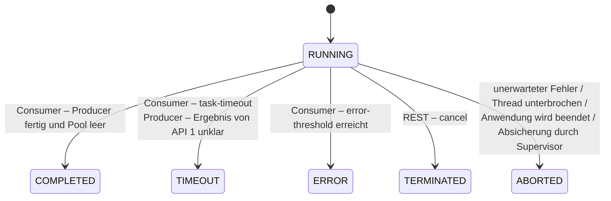

# Einmaliger Zustandsübergang im TaskContext

Übersetzung von [`implementierung_zh.md`](implementierung_zh.md), Abschnitt 2.2, Teil 1.

`TaskContext` ist die Zentrale einer Sandbox: Producer, Consumer, REST-Threads (Abbruch, Statusabfrage), Supervisor und der Shutdown der Anwendung greifen nebenläufig darauf zu. Er enthält keine Ablauflogik. Eine seiner Aufgaben ist der einmalige Übergang aus `RUNNING` in einen Endzustand.

`finish(endState, reason)` prüft und setzt unter `transitionLock` in einem Schritt: Nur solange der Zustand noch `RUNNING` ist, setzt der Aufruf den Endzustand und liefert `true`. Jeder spätere Aufruf liefert `false` und ändert nichts.

**Warum:** Mehrere Threads können die Aufgabe fast gleichzeitig beenden wollen, etwa wenn der Consumer gerade `COMPLETED` festgestellt hat und die Benutzer:in im selben Moment abbricht. Es darf nur einen Endzustand geben, und er muss stabil bleiben; sonst wiche der in die Cloud geschriebene Zustand vom lokal sichtbaren ab. Deshalb gilt: Wer zuerst kommt, gewinnt. Der unterlegene Aufrufer erkennt am Rückgabewert, dass sein Aufruf nicht gewirkt hat; `cancel` protokolliert dann zum Beispiel, dass die Aufgabe bereits beendet ist.

Wer die Aufgabe beenden kann:

| Auslöser | Thread | Endzustand | Grund (Beispiel) |
|---|---|---|---|
| Producer fertig und Status-Pool leer | Consumer | `COMPLETED` | `inbox vollständig übermittelt, alle Ergebnisse verarbeitet` |
| Laufzeit erreicht `task-timeout` | Consumer | `TIMEOUT` | `maximale Laufzeit (task-timeout) überschritten`, gegebenenfalls ergänzt um die letzte fehlgeschlagene Statusabfrage (Cloud-API 2) |
| Ergebnis beim Übermitteln eines Batches unklar | Producer | `TIMEOUT` | `Cloud-API 1 (Batch übermitteln): Ergebnis unklar, keine Antwort innerhalb von submit-timeout` |
| Fehlerzähler erreicht `error-threshold` | Consumer | `ERROR` | `Fehlerschwelle (error-threshold) erreicht` |
| Abbruch von außen | REST-Thread | `TERMINATED` | `Abbruch über die REST-API` |
| unerwarteter Fehler in Producer oder Consumer | der betroffene Thread | `ABORTED` | `Producer fehlgeschlagen: …` |
| Thread beim Warten unterbrochen | der unterbrochene Thread | `ABORTED` | `beim Warten unterbrochen` |
| Anwendung wird beendet | Shutdown-Thread von Spring | `ABORTED` | `Anwendung wird beendet` |
| beide Threads beendet, aber kein Endzustand gesetzt (Absicherung) | Supervisor | `ABORTED` | `Threads endeten ohne Endzustand` |
